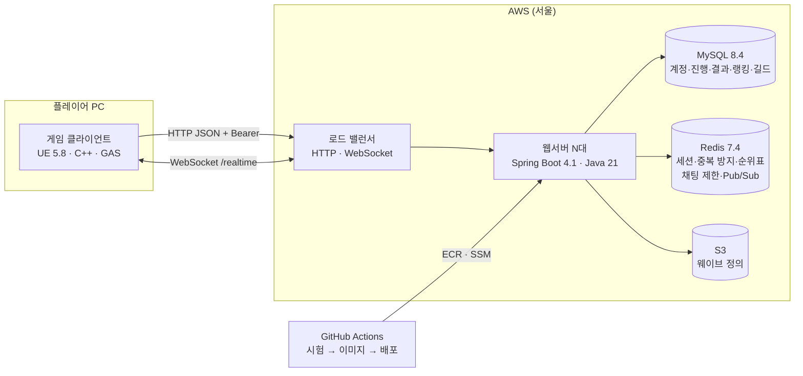

# ProjectWarrior · PW01


**혼자 웨이브를 막아 내는 액션 게임(Unreal Engine 5.8)과, 그 성장·스테이지·랭킹·길드·채팅을 서버가 원본으로 판정하는 게임 서버(Spring Boot 4)를 만든 팀 프로젝트입니다.**

이 저장소(PW01)는 **작업 공간 루트**입니다. 게임과 웹서버는 안쪽 폴더에 각각 별도 저장소로 두고, 이곳에는 둘 사이의 약속(명세)·흐름도·공통 규칙을 둡니다.

| 저장소 | 내용 | 기준 브랜치 |
|---|---|---|
| **PW01** (여기) | 게임 ↔ 서버 명세(`docs/contracts/`), 흐름도(`docs/flows/`), 공통 규칙·스크립트 | `main` |
| [ProjectWarrior](https://github.com/NBCGameServerCamp09Team01/ProjectWarrior) | 게임 클라이언트 — UE 5.8.3, C++, GAS | `dev` |
| [PW01WebServer](https://github.com/NBCGameServerCamp09Team01/PW01WebServer) | 게임 서버 — Spring Boot 4.1, Java 21, MySQL, Redis | `dev` |

---

## 프로젝트 목표

**사용자 목표**
1. 스테이지마다 몰려오는 적과 보스를 막아 내고, 결과로 경험치·레벨·스탯 포인트를 얻어 성장한다.
2. 스탯 투자·스킬 해금·난이도 선택으로 다음 판을 준비하고, 랭킹으로 기록을 겨루며, 길드·채팅으로 다른 플레이어와 이어진다.
3. 판 도중 게임이 꺼져도 다시 로그인해 같은 판을 이어 한다.

**기술 목표**

| 목표 | 쉽게 말하면 |
|---|---|
| **점수·보상은 서버가 정한다** | 게임 화면에서 값을 바꿔도, 보상·레벨·포인트·스테이지 구성은 서버가 계산한 대로 남는다(부정행위 방지). |
| **두 번 눌러도 한 번만** | 인터넷이 잠깐 끊겨 같은 요청이 다시 가도, 보상이나 채팅이 두 번 들어가지 않는다. |
| **사람이 몰려도 버틴다** | 서버를 여러 대로 늘려도 똑같이 동작하고, 서로 다른 서버에 붙은 사람끼리도 채팅·알림이 오간다. |
| **서버를 끄지 않고 업데이트** | 적 구성·난이도 같은 스테이지 내용을 서버 점검 없이 바꾼다. 잘못된 내용이면 바꾸지 않고 이전 내용을 그대로 쓴다. |
| **약속을 먼저 정하고 만든다** | 게임과 서버가 주고받을 내용을 문서로 먼저 정하고 서로 검토한 뒤 만들어, 따로 만들어도 맞물린다. |
| **자동으로 검사하고 배포한다** | 코드를 올릴 때마다 자동 시험을 돌리고, 통과해 합쳐지면 서버에 자동으로 올라간다. |

---

## 전체 구조



- 전투·AI·스테이지 진행은 게임이 혼자 돌리고, 계정 값을 바꾸는 일(결과·투자·해금·채팅 등)은 서버가 판정합니다.
- 기능 흐름은 [docs/flows/](docs/flows/)에 실제 클래스·함수 이름으로 그린 sequenceDiagram이 있습니다.

## 주요 기능

| 영역 | 기능 | 명세 |
|---|---|---|
| 계정 | 가입·로그인·세션 유지(하트비트·WebSocket Ping/Pong)·다른 곳 로그인 처리, 계정 스냅샷 동기화 | [auth-api](docs/contracts/auth-api.md) · [account-api](docs/contracts/account-api.md) |
| 스테이지 | 지역·스테이지 정의, 판 시작(서버가 웨이브 구성·난이도 배율을 정해 고정), 체크포인트·이어하기, 결과 제출·보상 | [stage-api](docs/contracts/stage-api.md) · [stage-play-api](docs/contracts/stage-play-api.md) · [result-api](docs/contracts/result-api.md) |
| 성장 | 스탯 투자, 스킬 해금(조건 판정) | [stat-api](docs/contracts/stat-api.md) · [skill-api](docs/contracts/skill-api.md) |
| 소셜 | 랭킹(스테이지·지역·전체·진행, 전체·주간, 난이도별), 길드(찾기·만들기·가입·승인·탈퇴·해체), 전체·길드 채팅(횟수 제한·도배 쉬기) | [ranking-api](docs/contracts/ranking-api.md) · [guild-api](docs/contracts/guild-api.md) · [chat-api](docs/contracts/chat-api.md) |
| 실시간 | WebSocket 연결, 서버 사이 전달(Redis Pub/Sub), 접속 상태 | [realtime-api](docs/contracts/realtime-api.md) |
| 게임플레이 | GAS 전투, AI·보스 패턴(비헤이비어 트리·EQS), 스테이지 흐름·웨이브 스폰, 상점·인벤토리, 튜토리얼 | 게임 저장소 |

공통 규칙(경로는 기능 이름부터·버전 없음, 시각 UTC, 오류 응답 `{code, message, path, retryable, errors}`, 재전송, 모르는 필드)은 [docs/contracts/README.md](docs/contracts/README.md), Redis 키는 [redis-keys.md](docs/contracts/redis-keys.md)에 있습니다.

## 기술 스택

| 영역 | 사용 |
|---|---|
| 게임 | Unreal Engine 5.8.3, C++, Gameplay Ability System, Enhanced Input, UMG, Behavior Tree·EQS, ALS(Community) |
| 서버 | Java 21, Spring Boot 4.1(Web MVC·Data JPA·WebSocket·Actuator), Flyway, Gradle 9.5 |
| 저장소 | MySQL 8.4, Redis 7.4(Lua·Pub/Sub) |
| 시험 | JUnit 6, Testcontainers(MySQL·Redis), UE Automation, Postman |
| 배포 | Docker, AWS(ALB·EC2·RDS·ElastiCache·S3·ECR·SSM·Parameter Store), GitHub Actions + OIDC |

## 팀

| GitHub | 주로 맡은 영역(커밋 기준) |
|---|---|
| [leejunhyeok3907](https://github.com/leejunhyeok3907) | 게임 코드 소유, 전투(GAS)·AI·보스 패턴·튜토리얼 |
| [Sang-Hyun-Kim](https://github.com/Sang-Hyun-Kim) | 웹서버 기반·배포 파이프라인, 스테이지 정의·랭킹·길드·접속 상태, 웨이브 정의 S3 |
| [Juunnmmoo](https://github.com/Juunnmmoo) | 게임 로그인·실시간 연결·이어하기(체크포인트)·상점·인벤토리, 스테이지 맵 |
| [J9214](https://github.com/J9214) | 인증·계정 서버, 결과·보상, 스탯·스킬, 계정 스냅샷, 서버 주관 웨이브·난이도, 채팅, 배포 서버 통합 점검 |

---

## 작업 공간 사용법

### 구조

```
PW01/                          ← Root 저장소 (PW01)
├─ README.md                   ← 이 파일
├─ AGENTS.md                   ← 공통 규칙(사람·AI 에이전트)
├─ CLAUDE.md                   ← @AGENTS.md (Claude Code용 import)
├─ .mcp.json                   ← MCP 서버 설정 (Unreal 에디터 내장 MCP 서버)
├─ .claude/settings.json       ← Claude Code 공유 설정 (나머지 .claude/ 는 개인, 무시)
├─ docs/                       ← 팀 공통 문서
│   ├─ README.md               ← 문서 지도
│   ├─ overview.md             ← 시스템 전체 구조
│   ├─ git-workflow.md         ← 브랜치·커밋·LFS 규칙
│   ├─ contracts/              ← 게임 ↔ 웹서버 명세 (API, Redis 키)
│   ├─ flows/                  ← 기능 흐름도
│   └─ images/                 ← README 그림
├─ tools/                      ← 공유 스크립트 (setup / pull-all / status-all)
├─ ProjectWarrior/             ← 별도 저장소: UE 5.8.3 게임 (Root는 무시)
└─ PW01WebServer/              ← 별도 저장소: Spring Boot 백엔드 (Root는 무시)
```

Root는 `ProjectWarrior/`, `PW01WebServer/`를 `.gitignore`로 무시합니다. submodule이 아닙니다.

### 받기

```bat
git clone https://github.com/NBCGameServerCamp09Team01/PW01.git
cd PW01
tools\setup.bat
```

- 게임만 받으려면 `tools\setup.bat game`, 웹서버만 받으려면 `tools\setup.bat web`
- 필요한 것: [Git for Windows](https://git-scm.com/download/win), [Git LFS](https://git-lfs.com)(게임 저장소), Unreal Engine 5.8.3(게임), JDK 21·Docker Desktop(웹서버)
- 각 저장소의 실행 방법은 그 저장소 README에 있습니다.

### 가장 중요한 규칙: git은 각 폴더 안에서

```
PW01\                 → Root 문서·규칙만 커밋
PW01\ProjectWarrior\  → 게임 파일은 여기서 git
PW01\PW01WebServer\   → 웹서버 파일은 여기서 git
```

- 지금 어느 저장소에 있는지 헷갈리면 `git rev-parse --show-toplevel`로 확인합니다.
- 세 저장소를 한 번에 보려면 `tools\status-all.bat`, 한 번에 받으려면 `tools\pull-all.bat`를 씁니다.
- 브랜치 → PR → 리뷰 후 병합. 브랜치·커밋 규칙은 [docs/git-workflow.md](docs/git-workflow.md), 공통 규칙은 [AGENTS.md](AGENTS.md)
- 게임과 서버 사이 약속을 바꿀 때는 **이 저장소의 명세를 먼저** 고치고 리뷰받은 뒤 코드를 바꿉니다.

### MCP 설정 (`.mcp.json`)

UE 5.8 내장 `ModelContextProtocol` 플러그인의 서버(`unreal-mcp`, `http://127.0.0.1:8000/mcp`)에 연결합니다. `ProjectWarrior/.mcp.json`과 같은 값이며, 에디터 설정(포트 8000, 경로 `/mcp`)을 바꾸면 두 파일을 함께 고칩니다.

- Unreal 에디터가 켜져 있고 MCP 서버가 떠 있어야 연결됩니다. 안 뜨면 에디터 콘솔에서 `ModelContextProtocol.StartServer`를 실행합니다.
- 접속 키 같은 비밀값은 이 파일에 적지 않고 환경변수로 넘깁니다.

### 개인 파일

- `CLAUDE.local.md`, `docs_local/`, `.claude/`(settings.json 제외)는 커밋되지 않습니다.
- `.env` 같은 환경 설정 파일도 커밋되지 않습니다. 비밀값은 저장소에 올리지 않습니다.
