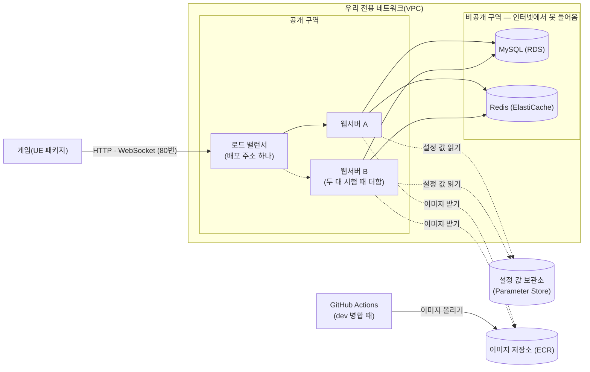
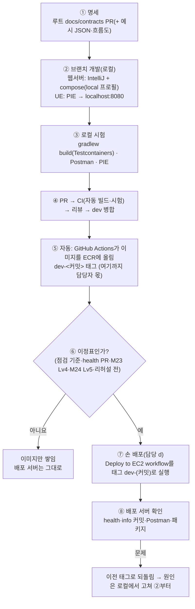
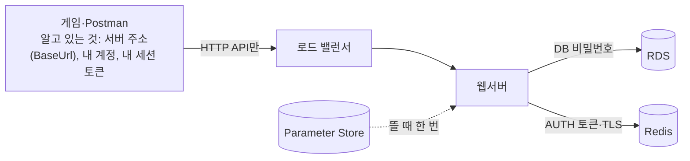

# AWS 배포 환경 안내 (팀원용)

> 대상: 팀원 모두(UE·웹서버). AWS를 몰라도 읽을 수 있게 썼습니다.
> 담당: d(Sang). AWS 콘솔·권한·비밀값은 담당만 다룹니다. 궁금한 것·필요한 것은 담당에게 요청해 주세요.
> 상태: **작성 중(10/17 기준)** — 〔 〕 칸은 해당 작업이 끝나면 채웁니다. 배포 과정 자체(병합 → 이미지 → 배포)는 [flows/deploy.md](flows/deploy.md), 장애 확인은 [flows/ops-health.md](flows/ops-health.md)를 봅니다.

## 1. 한 줄로

게임 서버가 **AWS(서울)에도 떠 있습니다.** 로컬 개발은 지금처럼 각자 PC(compose)에서 하고, **리허설(10/19)과 발표는 AWS 배포 서버**로 합니다. 게임은 **주소 하나**(로드 밸런서)로 붙습니다. 그 뒤의 웹서버는 **지금 한 대**이고, 두 번째 서버는 서버 두 대 시험(2차 통합 시험) 때 더합니다.

## 2. 구성 한 장

| 로컬(지금) | AWS 배포 서버 |
|---|---|
| `http://localhost:8080` | `http://pw01-alb-248607682.ap-northeast-2.elb.amazonaws.com` (포트 없음) |
| 웹서버 한 대(IntelliJ) | 지금 한 대(`pw01-app-1`). 두 대 시험 때 같은 이미지로 한 대를 더하고 로드 밸런서가 나눠 보냄 |
| compose의 MySQL·Redis | AWS가 운영하는 MySQL(RDS)·Redis(ElastiCache) |
| `.env` 파일 | 설정 값 보관소(Parameter Store) |
| `local` 프로필 | `prod` 프로필 |

## 3. 낱말 풀이

| 낱말 | 뜻(우리 프로젝트에서) | 로컬로 치면 |
|---|---|---|
| VPC | AWS 안에 만든 **우리 전용 네트워크** | 집 공유기 안의 네트워크 |
| 서브넷(공개·비공개) | VPC를 나눈 구역. 공개 구역에는 웹서버·로드 밸런서, 비공개 구역에는 DB·Redis | 공유기의 손님용 망·내부망 |
| 보안 그룹 | 서버마다 붙는 **방화벽**. "어느 포트를 누구에게 열지" | 윈도우 방화벽 규칙 |
| IAM 역할 | 서버가 다른 AWS 서비스를 쓸 때 들고 가는 **권한 카드**. 비밀번호·키 파일 없이 "이것만 해도 된다"를 AWS가 확인 | 폴더 읽기 권한 |
| 로드 밸런서(ALB) | 게임이 붙는 **고정 주소 하나**. 뒤의 서버 여러 대에 요청을 나눠 주고, 죽은 서버는 빼고 보낸다 | — |
| EC2 | AWS의 **가상 컴퓨터**. 여기서 웹서버 도커 이미지를 실행한다 | 내 PC |
| RDS / ElastiCache | AWS가 설치·백업·패치를 맡아 주는 **MySQL / Redis** | compose의 mysql·redis |
| Parameter Store | 서버가 뜰 때 읽는 **설정 값 보관소**. 비밀번호는 암호화해서 둔다 | `.env` |
| ECR | 웹서버 **도커 이미지 저장소**. `dev`에 병합하면 Actions가 여기에 올린다 | — |
| Session Manager | SSH 대신 AWS 콘솔에서 서버 터미널을 여는 길. 그래서 22번 포트를 열지 않는다 | 원격 데스크톱 |

## 4. 팀원에게 달라지는 것

### 4-1. UE 담당

| 무엇 | 할 일 | 언제 |
|---|---|---|
| 서버 주소 | `Config/DefaultGame.ini`의 `[/Script/ProjectWarrior.WarriorAuthSubsystem]` `PackagedBaseUrl=http://pw01-alb-248607682.ap-northeast-2.elb.amazonaws.com`(**포트 없음**, 게임 `dev`에 들어 있음). 패키지 빌드만 이 값을 쓰고, 에디터(PIE)는 코드 기본값 `BaseUrl`(`http://localhost:8080`)을 쓴다 — ini에 `BaseUrl` 줄은 두지 않는다. WebSocket 주소는 이 값에서 자동으로 만들어진다(`http` → `ws`, `/realtime`) | 됨. 패키지 10/18 |
| 서버 상태 확인 경로 | `[/Script/ProjectWarrior.WarriorApiSettings]` `HealthCheckPath`. 웹서버와 루트 명세에는 `GET /health`가 들어갔고, 게임 `dev` ini는 아직 `/actuator/health`(10/17) | 〔`/health`로 바꾸는 게임 PR 뒤〕 |
| 서버가 꺼졌을 때 | 로컬에서는 "응답 없음"(상태 0)이었지만, 배포 서버에서는 **로드 밸런서가 502·503을 돌려준다.** 지금 코드는 본문 없는 5xx도 다시 보낸다. 화면 문구가 "네트워크 오류"가 아니라 "서버 오류" 쪽으로 나올 수 있다 → E6·E7 확인 때 기대값을 이것으로 | 10/18 확인 |
| 실시간 연결 | 서버 한 대가 꺼지면 연결이 끊기고, 지금 코드가 다시 연결하면 **살아 있는 서버로** 붙는다. 수정할 것 없음 | — |
| 다른 곳 로그인 알림(4001) | 서버가 달라도 서버 사이 전달(Redis Pub/Sub)로 **보통 1초 안**에 온다. 전달을 놓치면 다음 Ping·Pong 때(최대 60초) 온다(`realtime-api.md` "서버 여러 대") | — |

### 4-2. 웹서버 담당

| 무엇 | 규칙 | 이유 |
|---|---|---|
| **서버 메모리에 상태를 두지 않는다** | 사용자·판·랭킹처럼 요청 사이에 남아야 하는 값은 **Redis 또는 MySQL**에. `static` 변수·`Map` 필드에 담아 두지 않는다 | 다음 요청은 다른 서버로 갈 수 있다. 한 서버의 메모리에 둔 값은 다른 서버가 모른다 |
| 게임에 알릴 때(`RealtimeNotifier`) | 보내기 넷(`send`·`sendToAccounts`·`sendToGuild`·`sendToAll`)만 부른다(DB 커밋 뒤). 받는 사람의 WebSocket이 **다른 서버**에 있어도 서버 사이 전달(Redis Pub/Sub)로 넘어간다 — Pub/Sub 채널을 직접 쓰지 않는다 | 이 서버의 연결 목록은 이 서버에 붙은 사람만 안다(`flows/realtime-relay.md`) |
| 주기 작업(전용 스케줄러) | **서버마다 각각 돈다.** 두 번 돌아도 안전하게(조건부 갱신·Redis 잠금) 만들거나, 한 서버에서만 돌게 설정 값으로 끈다 | 누적 통계 대조·랭킹 다시 채우기·길드 채팅 보관 지우기(`GuildChatCleanupJob`, 매일 03:30 UTC)가 이미 이렇게 되어 있다 |
| 새 환경 변수 | 세 곳에 함께 적는다: 웹서버 `docs/overview.md` 환경 변수 표 · 견본 파일(`.env.example`, 값 비움) · Parameter Store(담당에게 요청) | 빠지면 배포 서버가 뜨지 않는다(`prod`는 기본값이 없게 되어 있음) |
| 비밀값 | 코드·문서·커밋·로그에 넣지 않는다. 배포 서버의 비밀번호는 담당만 Parameter Store에 넣는다. AWS 액세스 키는 만들지 않는다 | 루트 `AGENTS.md` 4장 |
| 이미지 | `dev`에 병합하면 Actions가 자동으로 이미지를 만들어 ECR에 올린다(`dev-<커밋>` 태그). 실패하면 `dev` 커밋 옆에 빨간 X — 팀원 PR에는 영향 없음 | [flows/deploy.md](flows/deploy.md) |
| Redis 접속 | 배포 서버는 Redis와 **암호화(TLS) + 비밀번호**로 통신한다. 코드는 그대로이고 설정 값으로만 켠다 | — |

### 4-3. 모두

- 배포 서버 상태는 담당에게 물어보거나 〔운영 주소 표 — 판 15 뒤〕를 본다. 관리용 주소(Actuator, 8081)는 **밖에서 열리지 않는다.**
- 배포 서버의 데이터(시험 계정 등)는 **리허설 전에 정리**한다. 배포 서버에서 만든 계정은 지워질 수 있다.
- 배포 서버에서 오류가 나면 응답 헤더의 `X-Request-Id` 값을 담당에게 알려 준다. 담당이 그 번호로 서버 로그를 찾는다([flows/ops-health.md](flows/ops-health.md)). 서버가 두 대가 되면 두 서버의 로그를 모두 본다.

## 4-4. 기능 하나(M-X)를 만들 때: 로컬부터 배포 서버까지

**개발·시험은 로컬에서 한다. 배포 서버는 "이정표 때 한 번에 확인하는 곳"이다.** 병합할 때마다 배포하지 않는다.

| 단계 | 누가 | 어디서 | 확인할 것 |
|---|---|---|---|
| ① 명세 | 기능 담당 | 루트 PR | API·오류 코드·Redis 키가 명세에 먼저(루트 `AGENTS.md`) |
| ②③ 개발·시험 | 기능 담당 | 내 PC | `gradlew build` 통과, Postman·PIE로 경우별 확인 |
| ④ PR | 기능 담당 + 리뷰어 | GitHub | CI 통과, 리뷰 1명 |
| ⑤ 이미지 | 자동 | GitHub Actions → ECR | `dev` 커밋 옆 초록 체크(빨간 X면 담당 d가 봄) |
| ⑥⑦ 배포 | 담당 d | GitHub Actions(손 실행) → AWS | 이정표 때만. 자동 배포는 꺼 둠(`AUTO_DEPLOY=false`, [flows/deploy.md](flows/deploy.md)) |
| ⑧ 배포 확인 | 담당 d + 기능 담당 | 배포 주소 | 아래 "배포 서버에서만 보이는 것" |

**배포 서버에서만 보이는 것**(로컬에서 대신 확인할 방법이 있으면 함께)

| 조건 | 로컬 | 배포 서버 | 기능 담당이 미리 할 일 |
|---|---|---|---|
| Redis 암호화(TLS) | 없음 | 있음(필수) | 새 Redis 사용(특히 Pub/Sub 구독)은 Spring 기본 연결을 쓴다 — 따로 연결을 만들지 않는다 |
| 웹서버 두 대 + 로드 밸런서 | 한 대 | 지금 한 대, 두 대 시험 때 두 대 | 앱을 포트 둘로 띄워 번갈아 요청해 본다. 서버 메모리에 상태를 두지 않는다(4-2) |
| WebSocket 유휴 끊김 | 없음 | 로드 밸런서 120초 | Ping 주기를 바꾸면 담당 d에게 알림 |
| prod 프로필·설정 값 | local 프로필·`.env` | `prod`·Parameter Store | **새 환경 변수 = 세 곳**(4-2) + 담당 d에게 Parameter Store 요청 |
| 새 마이그레이션 | 내 DB | 빈 RDS에 차례로 | 번호 = PR 직전 `dev` 마지막 + 1. `dev`에 병합된 파일은 고치지 않는다 |
| 관리 포트 분리 | 8080 하나 | 8080·8081 | Actuator·관리 기능은 8081에서만 열린다 |
| 패키지 빌드 | PIE | ini의 배포 주소 | 4-1 |

**이렇게 하는 이유**: 배포 서버는 하나뿐이고 리허설·발표가 쓴다. 개발 중인 기능을 계속 올리면 시연 서버가 흔들린다. 반대로 "배포에서만 보이는 조건"은 이정표 때 모아서 확인하고, 문제가 나면 **이전 태그로 되돌린 뒤 로컬에서 고친다.**

## 4-5. 비밀은 두 종류 — 게임·Postman은 DB·Redis 비밀번호를 모른다(모르는 것이 맞다)

| | 서버만 아는 비밀(인프라) | 사용자가 아는 비밀(계정) |
|---|---|---|
| 무엇 | DB 주소·아이디·비밀번호, Redis 주소·AUTH 토큰 | 로그인 아이디·비밀번호 → 로그인하면 받는 세션 토큰(10분, heartbeat로 연장) |
| 누가 아나 | 웹서버 컨테이너(뜰 때 Parameter Store에서 받음), 담당 d | 그 사용자(게임·Postman) |
| 어디 있나 | 로컬: 각자 `.env` / 배포: Parameter Store(암호화) — **값이 서로 다르다**(같은 이미지, 다른 설정) | 게임 메모리, Postman 변수 |
| 쓰는 길 | 웹서버 → DB·Redis(비공개 구역, 웹서버 보안 그룹만) | 게임 → 로드 밸런서 → 웹서버 API(`Authorization: Bearer …`) |

- 게임 설정(ini)에 들어가는 것은 **서버 주소·시간 제한·재시도 같은 동작 값뿐**이다. 비밀번호·DB 주소는 넣지 않는다(넣어도 쓸 길이 없다 — DB·Redis는 인터넷에서 닿지 않는다).
- 게임 패키지 안의 파일은 **누구나 열어 볼 수 있다**고 생각하고 만든다. 그래서 클라이언트에 비밀을 두지 않고, 판정·값은 서버가 갖는다(대계획 원칙 1).
- 로컬과 배포의 DB·Redis 비밀번호가 다른 것은 **의도한 것**이다. 한쪽이 새어도 다른 쪽은 안전하고, 코드·이미지는 그대로다.
- 세션 토큰도 비밀이다: 화면 캡처·대화·문서에 남기지 않는다.

## 5. 왜 이렇게 만들었나(발표·질의응답용)

| 고른 것 | 이유 |
|---|---|
| DB·Redis를 비공개 구역에, 보안 그룹은 "웹서버에게만" | 인터넷에서 DB에 직접 닿을 길이 없다. 서버를 다시 만들어 IP가 바뀌어도 규칙은 그대로다(IP가 아니라 "이 그룹이 붙은 서버"로 연다) |
| 게임 주소는 인터넷 전체에, 22번·8081은 닫음 | 게임 API는 원래 공개 서비스다(로그인부터). 리허설·발표 장소의 IP를 미리 모르므로 IP로 막으면 우리 시연이 막힐 위험이 더 크다. 관리 포트·SSH는 닫는다 |
| NAT 게이트웨이 없음 | 하루 약 1.4달러로 DB보다 비싸고, 비공개 구역의 DB·Redis는 인터넷이 필요 없다. 현업에서는 웹서버도 비공개 구역에 두고 NAT를 쓰는 일이 많다 — 비용 때문에 고른 것 |
| 로드 밸런서 + 서버 두 대 | 게임 주소가 하나로 고정되고, 한 대를 꺼도 게임이 계속된다(E9). "서버가 상태를 들지 않는다"(Stateless)를 보이는 장면 |
| 비밀값은 Parameter Store + IAM 역할 | 이미지·GitHub에 비밀번호가 없다. 같은 이미지가 로컬은 `.env`, AWS는 보관소 값으로 뜬다 |
| GitHub Actions는 OIDC 역할로 | AWS 액세스 키를 GitHub에 넣지 않는다. `dev` 브랜치의 이 저장소만 이미지를 올릴 수 있다 |
| 예산 알림·태그·정리 순서 | 시간당 요금이 붙는 자원(EC2·RDS·ElastiCache·로드 밸런서)은 발표 뒤 정리한다 |

**공동 책임(AWS가 맡는 것 / 우리가 맡는 것)**: AWS = 데이터 센터·하드웨어, RDS·ElastiCache 설치·패치. 우리 = 네트워크·방화벽 설계, 권한, 비밀값, EC2 운영체제·도커, 앱 코드, 백업 설정, 비용.

## 6. 일정

| 날 | 생기는 것 | 팀원에게 |
|---|---|---|
| 10/14 | 네트워크·방화벽·권한, (되면) DB·Redis·설정 값 | 없음 |
| 10/16 | 배포 서버 + 로드 밸런서, **배포 주소** | UE: ini 주소(`PackagedBaseUrl`) — 됨 |
| 10/17 | 배포 방식 확정: **손 배포**(`AUTO_DEPLOY=false`) | `dev`에 병합해도 배포 서버는 바뀌지 않는다(이미지만 올라감) |
| 10/18 | 서버 두 대(2차 통합 시험) | 패키지 빌드(ini 주소) |
| 10/19 | G4 리허설·예외 검증 | 전원 |
| 〔G5 뒤〕 | 자원 정리 | 배포 서버가 사라진다 |

## 7. 자주 묻는 것

| 질문 | 답 |
|---|---|
| 로컬 개발이 바뀌나? | 아니다. 지금처럼 compose + `local` 프로필 |
| 내 PC에서 배포 서버 DB를 볼 수 있나? | 없다(비공개 구역). 필요하면 담당에게 요청 — 담당이 Session Manager로 확인 |
| 배포 서버를 다시 띄우고 싶다 | 담당에게 요청. 되돌리기(이전 이미지)도 담당이 한다 |
| AWS 콘솔 계정을 받을 수 있나? | 필요하면 읽기 전용부터. 담당에게 요청 |
| 배포 서버가 HTTPS가 아닌 이유 | 인증서에 도메인이 필요한데 도메인이 없다. 시연 범위라 HTTP로 하고 이유를 남긴다 |
