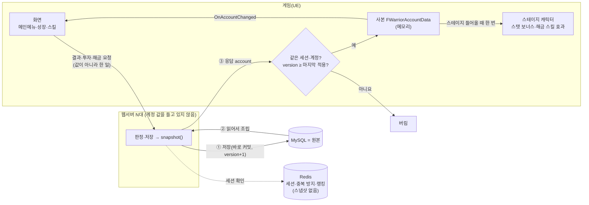
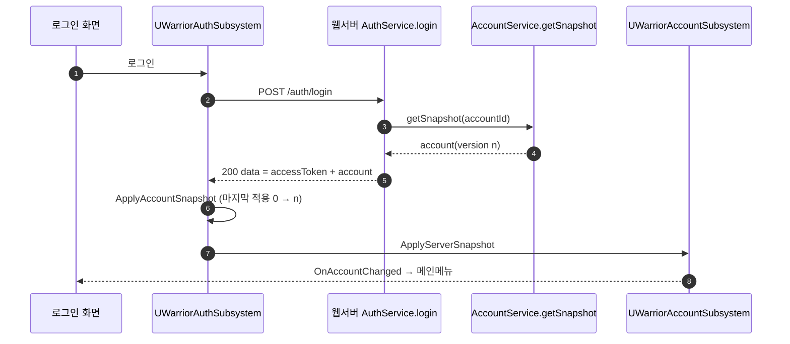
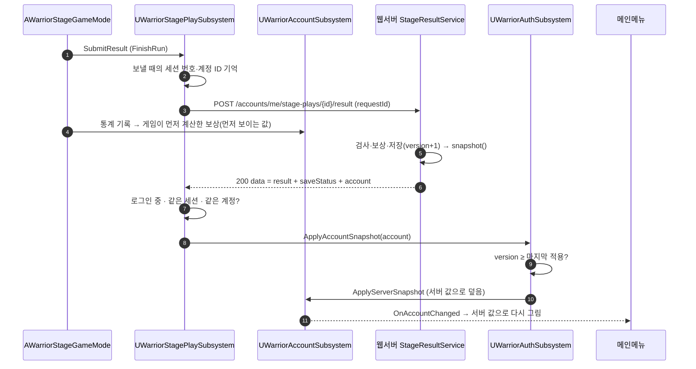
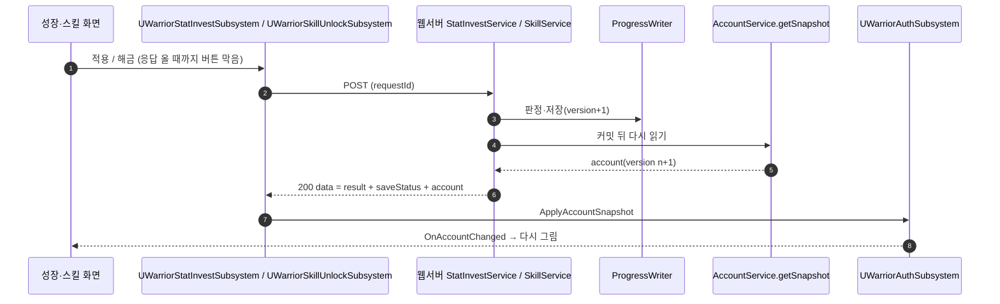
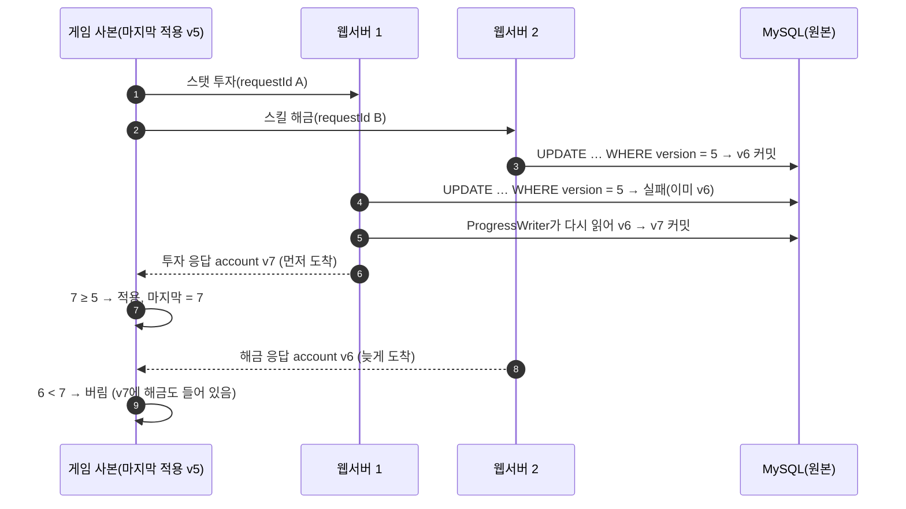
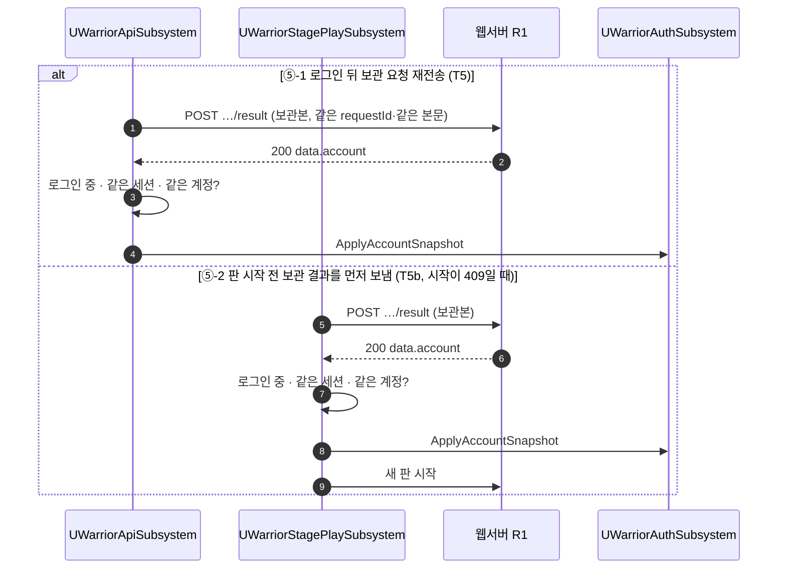
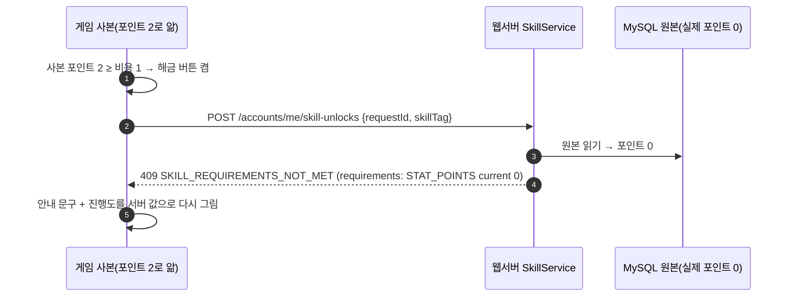
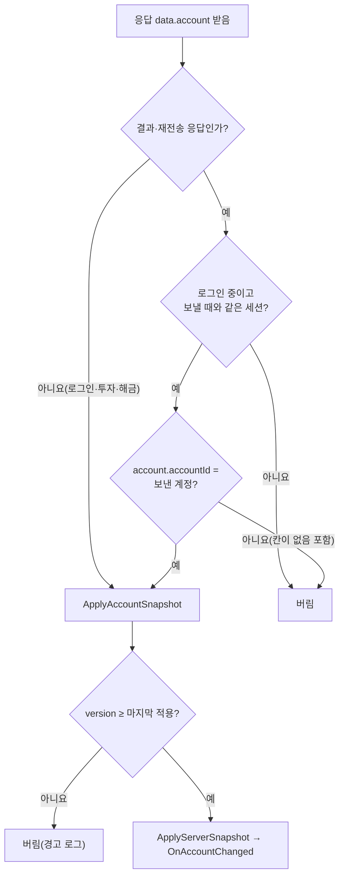

# 계정 스냅샷 흐름 (M25: 원본·사본·버전)

> 상태: 초안 · 명세: [account-api.md 계정 스냅샷](../contracts/account-api.md#계정-스냅샷) · [동기화 시점](../contracts/account-api.md#동기화-시점) · 관련 흐름: [play-checkpoint.md ④ 보관 결과 재전송](play-checkpoint.md)

계정 값(레벨·경험치·스탯 포인트·투자 스탯·해금 스킬)의 **원본은 서버 DB**입니다. 서버는 응답할 때마다 원본을 읽어 **한 곳에서** 계정 스냅샷을 만들고, 게임은 받은 스냅샷을 **사본**으로 들고 화면을 그립니다. 사본은 응답이 올 때만 바뀌고, `version`으로 늦게 온 옛 응답을 버립니다. 판 안 값(골드·인벤토리·체력)은 이 흐름이 아니라 [play-checkpoint.md](play-checkpoint.md)입니다.

② 결과 응답 적용과 ⑤-2 판 시작 전 보관 결과 적용은 M25 게임 작업에서 더합니다. 나머지는 이미 있는 흐름입니다.

## 참여자

| 이름 | 저장소·위치 | 하는 일 |
|---|---|---|
| `UWarriorAuthSubsystem` | 게임 `Auth/` | 로그인, `ApplyAccountSnapshot`(버전 비교, 마지막 적용 값 보관) |
| `UWarriorAccountSubsystem` | 게임 `Account/` | 사본 `FWarriorAccountData`, `ApplyServerSnapshot`, `OnAccountChanged` |
| `UWarriorStagePlaySubsystem` | 게임 `Network/` | 결과 제출과 응답 처리, 판 시작 전 보관 결과 재전송 |
| `UWarriorStatInvestSubsystem` · `UWarriorSkillUnlockSubsystem` | 게임 `Network/` | 스탯 투자·스킬 해금 요청 |
| `UWarriorApiSubsystem` | 게임 `Network/` | 요청 보내기, 로그인 뒤 보관 요청 재전송 |
| `AWarriorStageGameMode` | 게임 `GameModes/` | `FinishRun`: 결과 제출, 통계 기록 |
| 메인메뉴·성장·스킬 화면 | 게임 `Widgets/`·`Skill/` | `OnAccountChanged`를 받아 다시 그림 |
| `AccountService` | 웹서버 `account/` | `getSnapshot`(입구) → `snapshot()`(조립 한 곳) |
| `ProgressWriter` | 웹서버 `account/` | 계정 진행 저장. `version`이 부딪히면 다시 읽어 다시 저장 |
| MySQL | 웹서버 DB | 원본: `account_progress`(`version`) · `account_stat` · `account_skill` |

## 한눈에: 어디에 무엇이 있나

- 서버는 저장할 때마다 바로 DB에 반영하고 계정 값을 메모리에 두지 않습니다. 그래서 웹서버가 여러 대여도 모두 같은 원본을 봅니다.
- 게임은 값을 보내지 않고 "한 일"(결과, `{requestId, skillTag}` 등)만 보냅니다. 판정은 서버가 원본으로 합니다(⑥).

## ① 로그인 → 적용 (T1)

## ② 결과 제출 → 응답 account → 적용 → 메인메뉴 (T2)

- `SAVED`·`ALREADY_SAVED` 둘 다 적용합니다. `ALREADY_SAVED`의 `account`도 지금 값입니다.
- 저장이 실패해 결과를 보관하면 이 흐름이 없고, 메인메뉴는 게임이 먼저 계산한 값입니다. 재전송이 성공하면 ⑤로 맞춰집니다.

## ③ 투자·해금 → 적용 (T3·T4)

## ④ 동시에 온 저장과 늦은 응답 (버전의 두 역할)

- 서버의 `version`(3~5번): 동시에 들어온 저장을 하나씩 줄 세웁니다.
- 게임의 `version`(7·9번): 늦게 온 옛 응답을 버립니다. 더 큰 `version`이 이전 변경을 모두 담고 있어 잃는 값이 없습니다.

## ⑤ 보관 결과 재전송 → 적용 (T5·T5b)

- ⑤-1 뒤 진행 중 플레이 확인은 [play-checkpoint.md ④](play-checkpoint.md)로 이어집니다.

## ⑥ 사본이 옛 값일 때: 서버가 원본으로 거절

- 사본은 화면과 버튼, 판 시작 값에 씁니다. 사본이 틀려도 서버가 원본으로 다시 판정하므로 잘못 저장되지 않습니다.

## ⑦ 적용 판정

## 다음 단계에서 더할 흐름

- ⑧ 연결 밖 변경 알림(M25-B): 다른 기기·관리자·우편 지급처럼 이 게임의 HTTP 응답 밖에서 계정 값이 바뀌면, 서버가 실시간 `ACCOUNT_CHANGED {version}`을 보내고 게임이 `version`이 크면 `GET /accounts/me`로 다시 받습니다([realtime-api.md](../contracts/realtime-api.md)).
- 칸을 더할 때(난이도 해금·우편 배지 등)는 [account-api.md 넣지 않는 것](../contracts/account-api.md#넣지-않는-것)의 기준을 봅니다.
