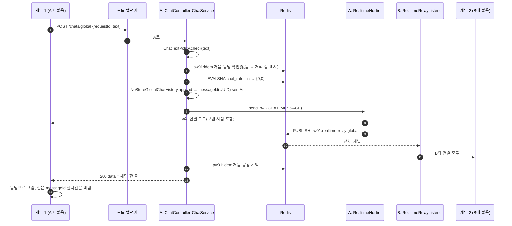
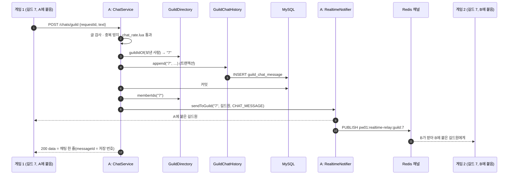
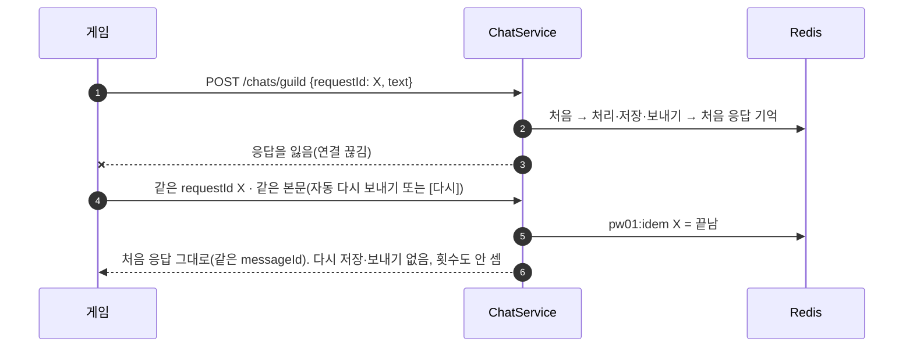
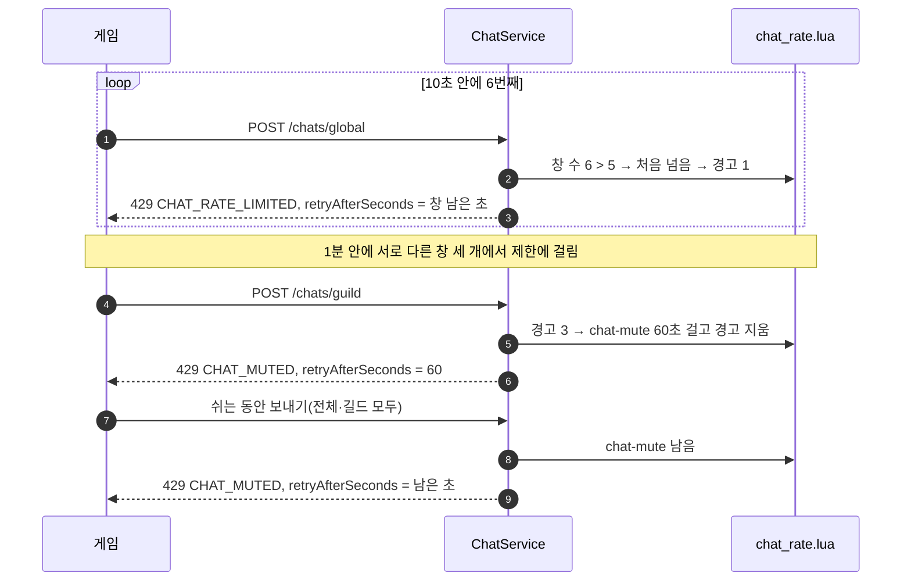
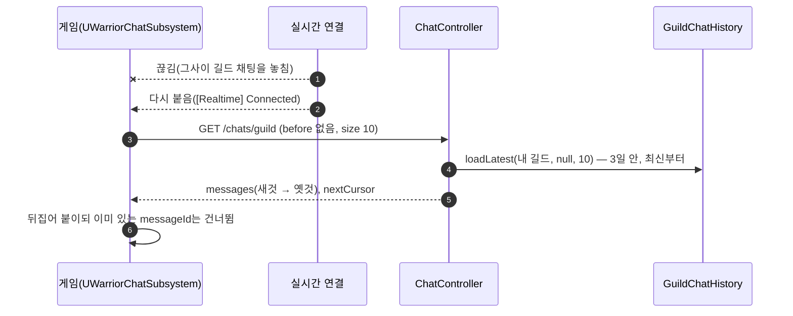
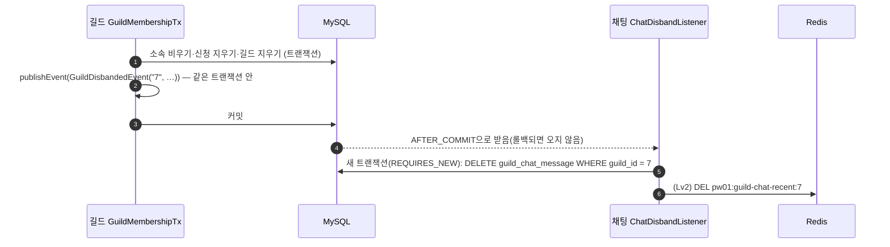

# 채팅 흐름 (M23 채팅)

> 상태: 초안(클래스 이름은 채팅 계획서 기준, 구현 PR에서 맞춤) · 명세: [chat-api.md](../contracts/chat-api.md), [realtime-api.md `CHAT_MESSAGE`](../contracts/realtime-api.md#메시지-종류) · Redis: [redis-keys.md 채팅](../contracts/redis-keys.md#채팅v16) · 서버 사이 전달: [realtime-relay.md](realtime-relay.md)

보내기는 HTTP(CH1·CH2), 받기는 실시간 연결(`CHAT_MESSAGE`)입니다. 보내는 HTTP를 받은 서버와 받는 사람의 WebSocket이 붙은 서버가 다를 수 있어, 서버 사이 전달(Redis Pub/Sub)로 넘깁니다.

- ① 전체 채팅(다른 서버로) · ② 길드 채팅(다른 서버로) · ③ 같은 요청을 다시 보냄 · ④ 횟수 제한과 도배 쉬기 · ⑤ 길드 없이 길드 채팅 · ⑥ 다시 붙어 길드 내역으로 채우기 · ⑦ 길드 해체 때 지우기 · ⑧ 보관 기간 지우기

## 참여자

| 이름 | 저장소·위치 | 하는 일 |
|---|---|---|
| `UWarriorChatSubsystem` | 게임 `Chat/` | 보내기(CH1·CH2)·내역(CH3), 실시간 `CHAT_MESSAGE` 받기(공용 `OnMessage` 구독), 탭별 줄 보관·`messageId` 겹침 제거 |
| 채팅 창(`UWarriorChatPanelWidget`, `WBP_ChatPanel`) | 게임 `Chat/`·에셋 | 메인메뉴 `Slot_Chat`에 들어가는 창. 탭·날짜선·`HH:MM`·입력·남은 초 |
| `ChatController` | 웹서버 `chat/controller` | CH1·CH2·CH3 |
| `ChatService` | 웹서버 `chat/service` | 판정 순서(글 → 중복 방지 → 횟수 제한 → 길드 → 저장 → 보내기) |
| `ChatTextPolicy` | 웹서버 `chat/service` | 글 규칙(코드 포인트 100, 제어 문자) |
| `IdempotencyService` | 웹서버 `common/idempotency` | 같은 `requestId`면 처음 응답(`pw01:idem`) |
| `RedisChatRateLimiter` | 웹서버 `chat/repository` | `chat_rate.lua`(횟수 제한 + 도배 쉬기) |
| `GuildDirectory` | 웹서버 `common/chat`(구현 `GuildDirectoryImpl`, 길드) | 보낸 사람의 길드, 길드원 목록 |
| `GuildChatHistory` | 웹서버 `common/chat`(구현 `GuildChatHistoryImpl`, 채팅) | 길드 채팅 저장(V11 `guild_chat_message`)·내역 |
| `GlobalChatHistory` | 웹서버 `common/chat`(구현 `NoStoreGlobalChatHistory`) | 전체 채팅 번호(UUID)·시각만 매김, 저장 안 함 |
| `RealtimeNotifier` | 웹서버 `realtime/service` | `sendToAll`·`sendToGuild` — 이 서버 연결에 바로, 다른 서버에는 채널로 |
| `ChatDisbandListener`·`GuildChatCleanupJob` | 웹서버 `chat/service` | 해체 이벤트 받아 지우기, 하루 한 번 보관 기간 지우기 |

## ① 전체 채팅 — 다른 서버에 붙은 사람에게

## ② 길드 채팅 — 커밋 뒤에, 그 길드원에게만

- 저장이 실패하면(503) 보내지 않습니다. 보내기 실패는 응답을 바꾸지 않습니다(놓칠 수 있음 — ⑥으로 채움).
- 받은 게임은 `guildId`가 지금 내 길드가 아니면 버립니다(막 나간 사람).

## ③ 같은 요청을 다시 보냄

- 다른 본문이면 409 `IDEMPOTENCY_KEY_REUSED`, 처음 요청이 아직 처리 중이면 409 `REQUEST_IN_PROGRESS`.

## ④ 횟수 제한과 도배 쉬기

- 게임은 429를 자동으로 다시 보내지 않고, 남은 초 동안 보내기 버튼을 막습니다.
- 서버가 둘이어도 같은 키를 스크립트 한 번으로 세므로, 서버를 바꿔 보내도 수가 같습니다.

## ⑤ 길드 없이 길드 채팅

| 요청 | 결과 |
|---|---|
| CH2 보내기 | 횟수 제한은 셈 → `guildIdOf` 빈 값 → 403 `GUILD_NOT_MEMBER` |
| CH3 내역 | 403 `GUILD_NOT_MEMBER`. 게임 길드 탭은 "길드에 가입하면 길드 채팅을 볼 수 있습니다" |

## ⑥ 다시 붙어 길드 내역으로 채우기

- 길드가 바뀔 때(`OnMyGuildChanged`)와 채팅 창을 열 때도 같은 순서입니다. 위로 끝까지 스크롤하면 `before = nextCursor`로 이전 10개를 받아 위에 붙입니다.
- 전체 채팅은 저장하지 않으므로 끊긴 동안의 것은 채우지 않습니다.

## ⑦ 길드 해체 때 지우기

- 길드는 채팅 표를 모릅니다(외래 키 없음). 지우기가 실패해도 그 길드를 읽을 사람이 없고 ⑧이 3일 뒤 치웁니다.

## ⑧ 보관 기간 지우기

- 하루 한 번(설정 `pw01.chat.cleanup.cron`, UTC) `DELETE … WHERE created_at < 지금 − 3일 LIMIT 1000`을 0줄이 될 때까지 짧은 트랜잭션으로 반복합니다.
- 서버 둘이 같이 돌아도 결과가 같습니다(잠금 없음). 내역은 지우기와 상관없이 늘 3일 안만 읽습니다.
