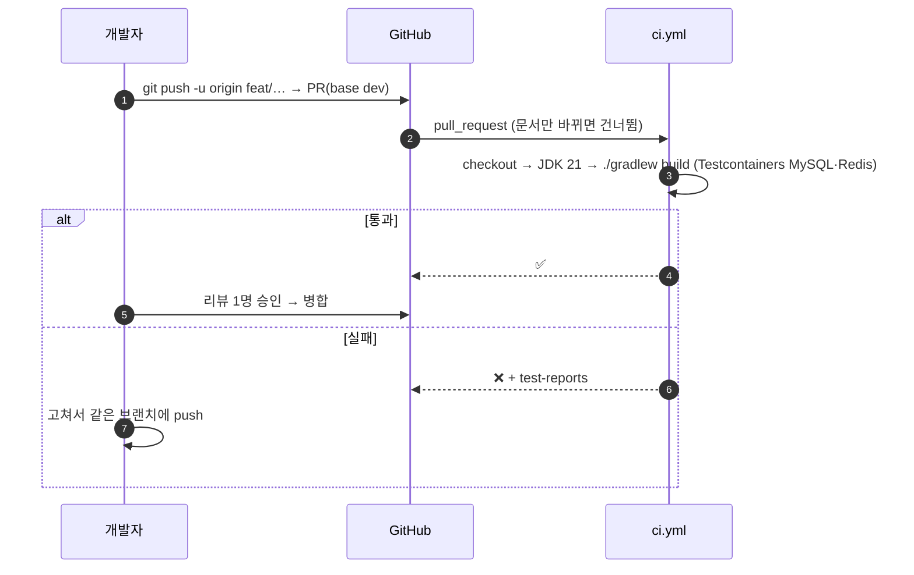
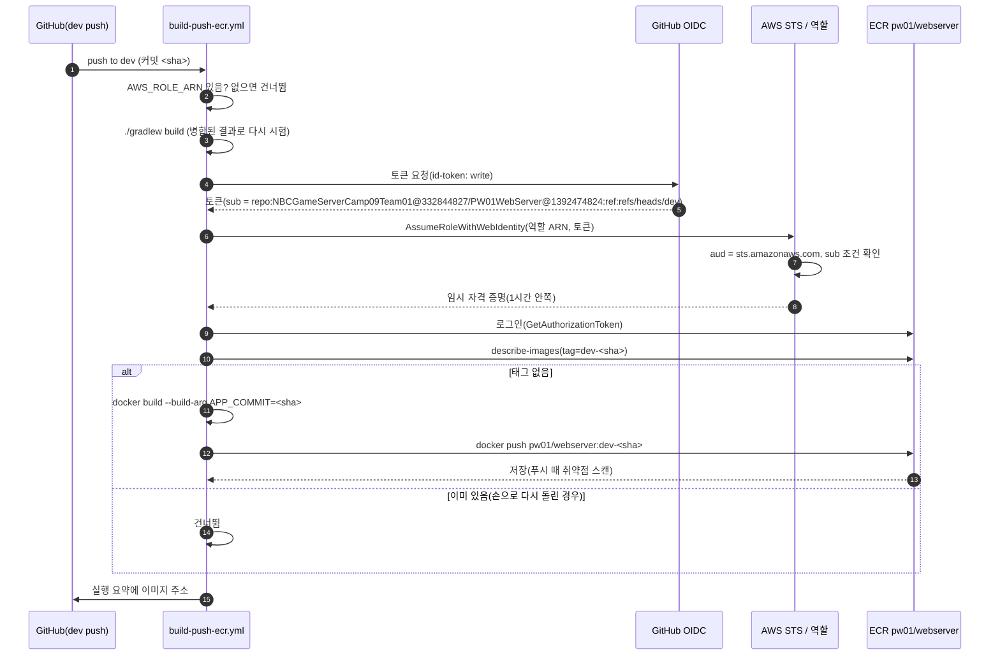
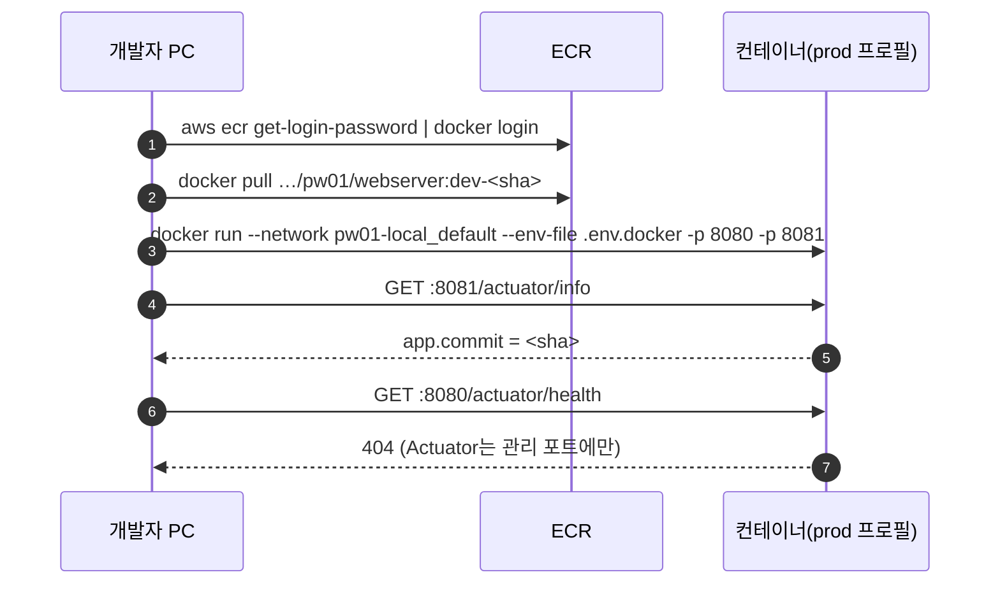

# 배포 흐름 (M14 1판: PR 검사 → dev 병합 → 이미지 → ECR)

> 상태: 1판 초안(웹서버 PR `feat/m14-image` 기준). 서버에 띄우기·되돌리기는 배포 단계 때 더합니다. · 파일: 웹서버 `.github/workflows/ci.yml`·`build-push-ecr.yml`, `Dockerfile` · 설명: 웹서버 `README.md` "6. 이미지"

웹서버 코드가 PR에서 시험을 거쳐 `dev`에 병합되고, 그 커밋이 이미지로 AWS ECR에 올라가기까지의 흐름입니다. AWS 접속에 액세스 키를 쓰지 않습니다(OIDC).

## 참여자

| 이름 | 위치 | 하는 일 |
|---|---|---|
| 개발자 | 로컬 | 작업 브랜치 → PR(base `dev`) |
| GitHub | PW01WebServer | PR·병합, Actions 실행 |
| `ci.yml`(CI) | `.github/workflows/` | PR마다 `./gradlew build`(시험 포함) |
| `build-push-ecr.yml`(Build and Push Image (ECR)) | `.github/workflows/` | `dev` push마다 시험 → 이미지 → ECR. 배포는 하지 않음(배포는 `deploy-<대상>.yml`로 따로) |
| GitHub OIDC | `token.actions.githubusercontent.com` | 실행마다 짧은 토큰 발급(저장소·브랜치가 담김) |
| AWS STS · IAM 역할 `pw01-gha-ecr-push` | AWS(전역) | 토큰의 저장소·브랜치가 `PW01WebServer`·`dev`일 때만 역할을 내줌 |
| ECR `pw01/webserver` | AWS ap-northeast-2 | 이미지 저장. 태그 = `dev-<커밋 해시 40자>`(만든 브랜치-커밋), 태그 변경 불가 |

저장소 변수(Secrets 아님): `AWS_REGION`, `AWS_ROLE_ARN`, `ECR_REPOSITORY`. `AWS_ROLE_ARN`이 없으면 이 작업은 건너뜁니다.

## ① PR → CI

## ② dev 병합 → 이미지 → ECR

- 다른 저장소·브랜치에서 온 토큰이면 STS 단계에서 거절합니다. 액세스 키는 어디에도 없습니다.
- `sub`에는 조직·저장소의 **숫자 ID**가 붙습니다(GitHub 불변 주체, 2026-07-15 이후 만든 저장소는 자동). 이름만 적은 옛 모양(`repo:조직/저장소:…`)으로 신뢰 조건을 쓰면 STS가 거절합니다(10/13 첫 실행). 실제 모양은 `GET https://api.github.com/repos/NBCGameServerCamp09Team01/PW01WebServer/actions/oidc/customization/sub`의 `sub_claim_prefix`로 확인합니다.
- 이미지의 `/actuator/info` `app.commit` = 커밋 해시 = 태그에서 `dev-`를 뺀 값([ops-health.md](ops-health.md) ①).
- 이미지는 `Dockerfile` 2단계: JDK 21에서 `bootJar` → JRE 21에 jar만, root 아닌 사용자, `.dockerignore`로 `.env*` 제외.

## ③ 받은 이미지 확인(사람)

## 뒤에 더할 것

- 서버에 띄우기(배포 단계), 상태 확인으로 새 서버를 받는 순서, 되돌리기(이전 커밋 태그로).
- 배포 승인을 GitHub 환경(environment)으로 하면 역할 신뢰 조건의 `sub`가 `repo:NBCGameServerCamp09Team01@332844827/PW01WebServer@1392474824:environment:<이름>` 모양으로 바뀝니다.
