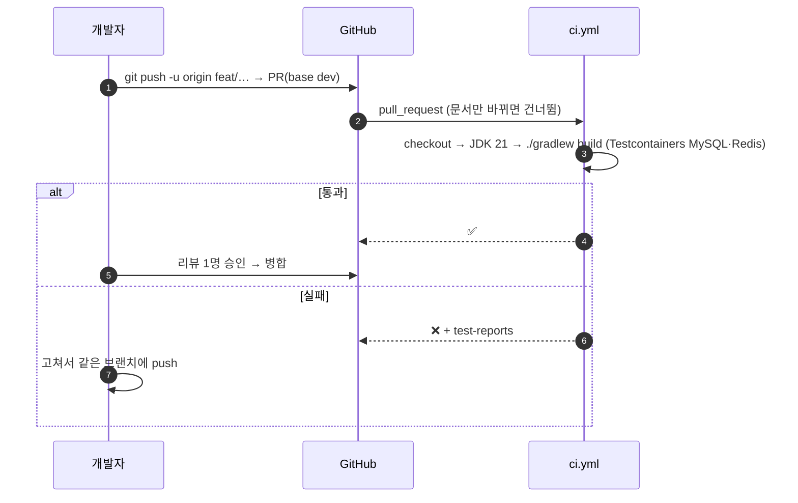
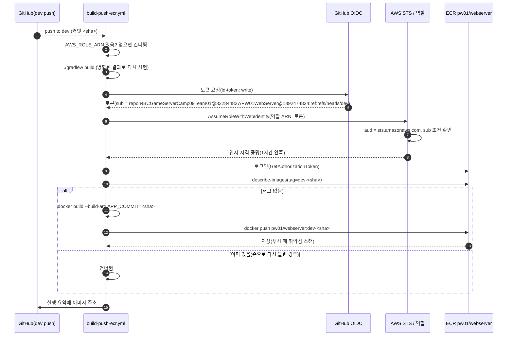
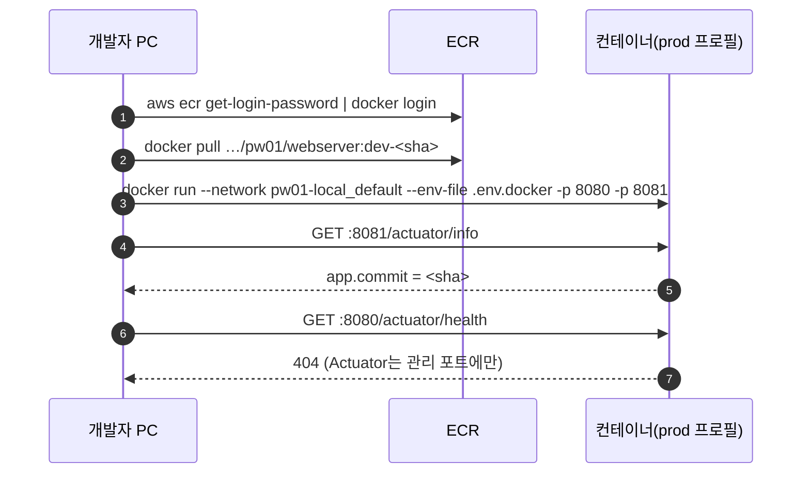
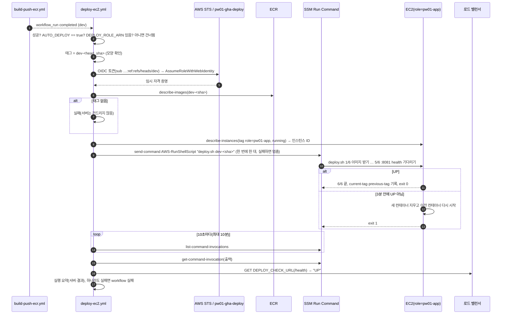
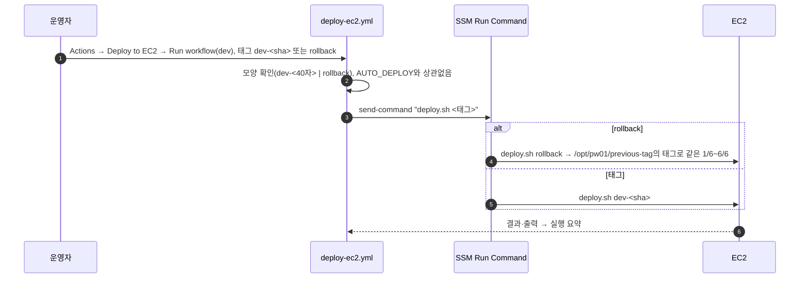

# 배포 흐름 (2판: PR 검사 → dev 병합 → 이미지 → ECR → EC2 자동 배포)

> 상태: 2판 초안(웹서버 PR `feat/deploy-cd` 기준, 10/15). 1판(①~③)은 `feat/m14-image` 기준. · 파일: 웹서버 `.github/workflows/ci.yml`·`build-push-ecr.yml`·`deploy-ec2.yml`, `Dockerfile`, `deploy/deploy.sh` · 설명: 웹서버 `README.md` "6. 이미지", `deploy/README.md`

웹서버 코드가 PR에서 시험을 거쳐 `dev`에 병합되고, 그 커밋이 이미지로 AWS ECR에 올라간 뒤 배포 서버(EC2)에 띄워지기까지의 흐름입니다. AWS 접속에 액세스 키를 쓰지 않습니다(OIDC).

## 참여자

| 이름 | 위치 | 하는 일 |
|---|---|---|
| 개발자 | 로컬 | 작업 브랜치 → PR(base `dev`) |
| GitHub | PW01WebServer | PR·병합, Actions 실행 |
| `ci.yml`(CI) | `.github/workflows/` | PR마다 `./gradlew build`(시험 포함) |
| `build-push-ecr.yml`(Build and Push Image (ECR)) | `.github/workflows/` | `dev` push마다 시험 → 이미지 → ECR. 배포는 하지 않음(배포는 `deploy-<대상>.yml`로 따로) |
| GitHub OIDC | `token.actions.githubusercontent.com` | 실행마다 짧은 토큰 발급(저장소·브랜치가 담김) |
| AWS STS · IAM 역할 `pw01-gha-ecr-push` | AWS(전역) | 토큰의 저장소·브랜치가 `PW01WebServer`·`dev`일 때만 역할을 내줌 |
| ECR `pw01/webserver` | AWS ap-northeast-2 | 이미지 저장. 태그 = `dev-<커밋 해시 40자>`(만든 브랜치-커밋), 태그 변경 불가 |
| `deploy-ec2.yml`(Deploy to EC2) | `.github/workflows/` | 이미지 workflow가 `dev`에서 성공하면 서버마다 `deploy.sh dev-<sha>`(자동, `AUTO_DEPLOY=true`일 때). 손 배포·되돌림 |
| AWS STS · IAM 역할 `pw01-gha-deploy` | AWS(전역) | 배포용 역할(올리기 역할과 따로). 태그 `role=pw01-app` 서버에 명령 보내기·결과 읽기만 |
| SSM Run Command | AWS ap-northeast-2 | 서버에서 `AWS-RunShellScript`로 `/opt/pw01/deploy.sh` 실행(22번 포트 없음) |
| EC2 `pw01-app-1`(+ 판 11 뒤 `pw01-app-2`) | AWS ap-northeast-2 | `deploy.sh`: 이미지 받기 → Parameter Store 값 → 컨테이너 바꾸기 → `:8081/actuator/health` UP 기다리기 → 실패면 이전 컨테이너로 |
| 로드 밸런서 `pw01-alb` | AWS ap-northeast-2 | 게임 주소. 배포 뒤 밖에서 `/health` 확인 |

저장소 변수(Secrets 아님): `AWS_REGION`, `AWS_ROLE_ARN`, `ECR_REPOSITORY`(이미지), `DEPLOY_ROLE_ARN`, `AUTO_DEPLOY`, `DEPLOY_CHECK_URL`(배포). `AWS_ROLE_ARN`·`DEPLOY_ROLE_ARN`이 없으면 그 작업은 건너뜁니다.

## ① PR → CI

## ② dev 병합 → 이미지 → ECR

- 다른 저장소·브랜치에서 온 토큰이면 STS 단계에서 거절합니다. 액세스 키는 어디에도 없습니다.
- `sub`에는 조직·저장소의 **숫자 ID**가 붙습니다(GitHub 불변 주체, 2026-07-15 이후 만든 저장소는 자동). 이름만 적은 옛 모양(`repo:조직/저장소:…`)으로 신뢰 조건을 쓰면 STS가 거절합니다(10/13 첫 실행). 실제 모양은 `GET https://api.github.com/repos/NBCGameServerCamp09Team01/PW01WebServer/actions/oidc/customization/sub`의 `sub_claim_prefix`로 확인합니다.
- 이미지의 `/actuator/info` `app.commit` = 커밋 해시 = 태그에서 `dev-`를 뺀 값([ops-health.md](ops-health.md) ①).
- 이미지는 `Dockerfile` 2단계: JDK 21에서 `bootJar` → JRE 21에 jar만, root 아닌 사용자, `.dockerignore`로 `.env*` 제외.

## ③ 받은 이미지 확인(사람)

## ④ 이미지 → EC2 자동 배포

- 서버가 한 대인 동안 배포마다 약 20초 503이 납니다. 시험 중에는 `AUTO_DEPLOY=false`로 끕니다(이미지는 계속 올라감).
- 이미지 workflow는 변수가 없어 올리기를 건너뛰어도 "성공"입니다. 그래서 배포 workflow가 ECR에 태그가 있는지 먼저 봅니다.
- `workflow_run`으로 도는 workflow는 기본 브랜치(`dev`)에서 돕니다 → OIDC `sub`가 `ref:refs/heads/dev`라 손 실행과 같은 신뢰 조건을 씁니다.
- 승인 단계(GitHub 환경)는 쓰지 않습니다. 쓰면 `sub`가 `repo:NBCGameServerCamp09Team01@332844827/PW01WebServer@1392474824:environment:<이름>` 모양으로 바뀌어 역할 신뢰 조건도 바꿔야 합니다.

## ⑤ 손 배포·되돌림

- 서버에서 직접 할 때: Session Manager → `sudo /opt/pw01/deploy.sh dev-<sha>` 또는 `sudo /opt/pw01/deploy.sh rollback`.
- 되돌림은 코드(컨테이너)만 되돌립니다. 데이터베이스 마이그레이션은 되돌아가지 않습니다.
- 서버의 `deploy.sh`는 workflow가 복사하지 않습니다. 원본(웹서버 `deploy/deploy.sh`)을 고쳐 병합하면 서버 파일도 사람이 바꿉니다(`deploy/README.md`).

## 뒤에 더할 것

- 서버 두 대(판 11): 한 대씩 배포할 때 대상 그룹에서 먼저 빼고(등록 취소 30초) 바꾼 뒤 다시 넣는 순서. 지금은 한 대씩 명령만 보내므로 그 서버가 바뀌는 동안 로드 밸런서가 대상 검사로 알아챌 때까지 일부 요청이 실패할 수 있습니다.
