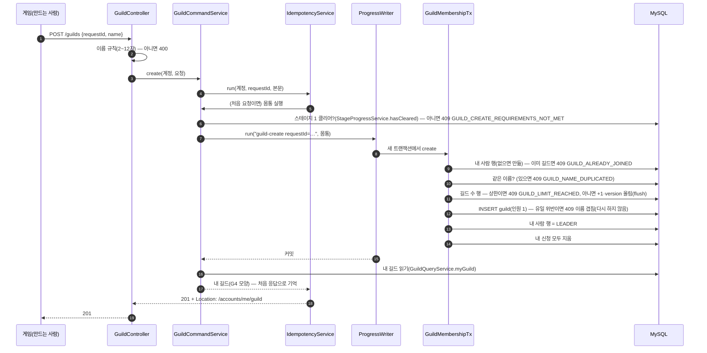
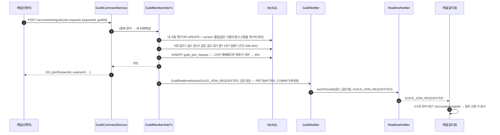
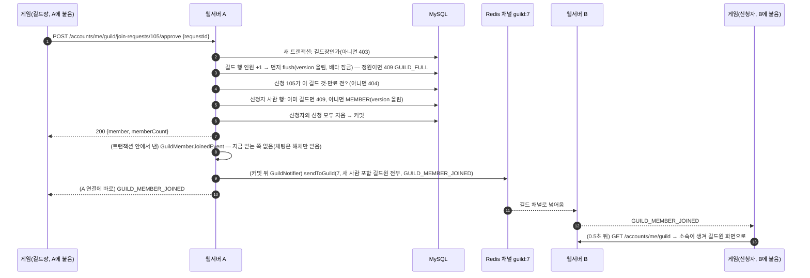
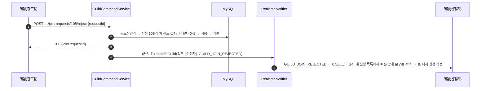
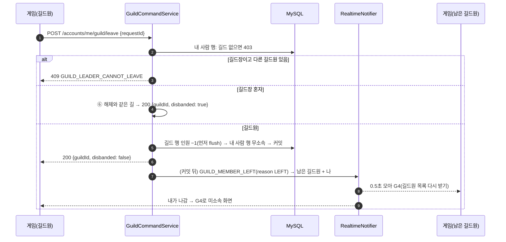
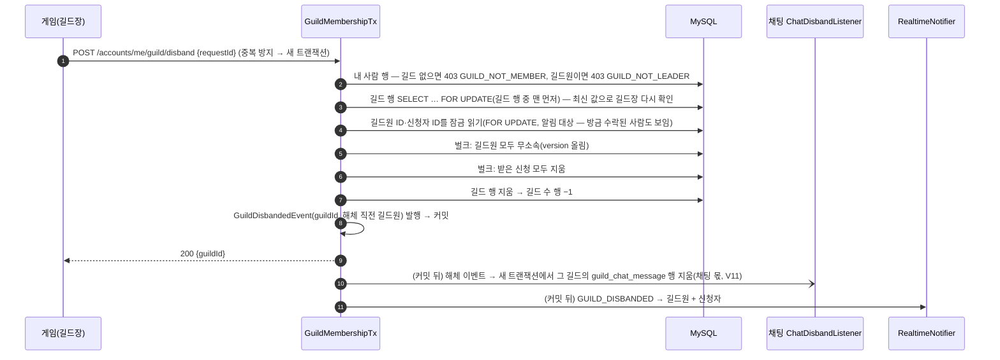
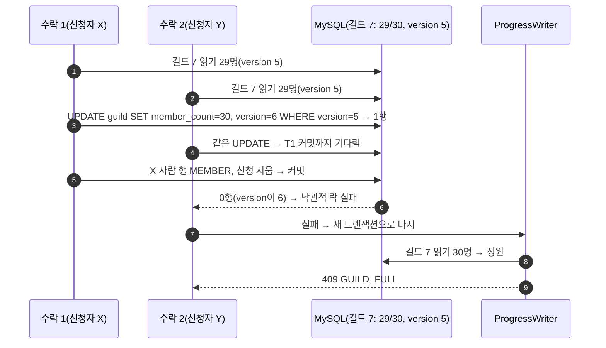
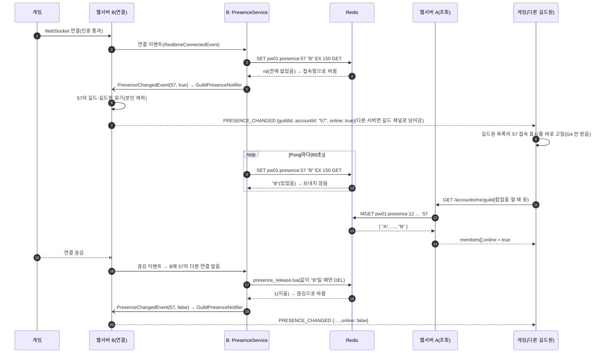

# 길드 흐름 (M23)

> 상태: 초안 · 명세: [guild-api.md](../contracts/guild-api.md) v1.1, [realtime-api.md 메시지 종류·길드 알림 처리·접속 표시 처리](../contracts/realtime-api.md#메시지-종류) v1.6 · Redis: [redis-keys.md 접속 상태·길드](../contracts/redis-keys.md#접속-상태v17) v1.8 · 서버 사이 전달: [realtime-relay.md](realtime-relay.md)
> 클래스·함수 이름은 구현 기준입니다(웹서버 #31·#33, 게임 #61·#62 — 10/17 `dev` 병합(웹서버 #37, 게임 #66). 10/16 대조·10/17 채팅 병합 뒤 다시 대조). 코드 이름이 바뀌면 이 문서를 같이 고칩니다.

- ① 만들기 · ② 신청 → 길드장 알림 · ③ 수락(신청자가 다른 서버) · ④ 거절 · ⑤ 탈퇴 · ⑥ 해체 · ⑦ 같은 길드에 수락 둘이 동시에(정원) · ⑧ 접속 표시

## 참여자

| 이름 | 저장소·위치 | 하는 일 |
|---|---|---|
| `UWarriorGuildSubsystem` | 게임 `Network/` | 길드 API 부르기, `GUILD_*`를 받아 0.5초 모아 `GET /accounts/me/guild`, `PRESENCE_CHANGED`는 길드원 목록을 바로 고침, `GetMyGuildId()`·`OnMyGuildChanged`(채팅이 씀) |
| `UWarriorRealtimeSubsystem` | 게임 `Network/` | 서버 메시지를 `OnMessage(type, id, data)`로 넘김 |
| `GuildController` · `MyGuildController` · `MyGuildJoinRequestController` | 웹서버 `guild/controller` | `/guilds…`(목록·상세·만들기) · `/accounts/me/guild…`(내 길드·받은 신청·수락·거절·탈퇴·해체) · `/accounts/me/guild-join-requests…`(내 신청·취소) |
| `GuildQueryService` | 웹서버 `guild/service` | 조회 조립(닉네임·접속·만들기 조건) |
| `GuildCommandService` | 웹서버 `guild/service` | 쓰기: `IdempotencyService.run` → (만들기만 스테이지 클리어 확인) → `ProgressWriter.run`(새 트랜잭션, 부딪히면 다시) → 트랜잭션 몸통. 유일·외래 키 위반을 409·404로 바꿈 |
| `GuildMembershipTx` | 웹서버 `guild/service` | 트랜잭션 몸통(`create`·`apply`·`approve`·`reject`·`leave`·`disband`). 잠금 순서(길드 수 행 → 길드 행 → 사람 행 → 신청 행)를 한곳에서 지키고, 길드원을 넣는 길은 `approve` 하나 |
| `AccountGuildReader` | 웹서버 `guild/service` | 사람 행 읽기(없으면 그 자리에서 무소속 행을 만듦) |
| `GuildNotifier` | 웹서버 `guild/service` | 커밋 뒤(AFTER_COMMIT) `RealtimeNotifier.sendToGuild` |
| `PresenceService` | 웹서버 `presence` | 연결 이벤트 → `pw01:presence:<계정>`, 읽기 `MGET`. 키가 바뀌면 `PresenceChangedEvent` |
| `GuildPresenceNotifier` | 웹서버 `guild/service` | `PresenceChangedEvent` → 본인을 뺀 길드원에게 `PRESENCE_CHANGED` |
| MySQL | `guild` · `account_guild` · `guild_join_request` · `guild_counter` | 원본 |
| Redis | `pw01:idem:…`, `pw01:presence:…`, 채널 `pw01:realtime-relay:guild:<길드 ID>` | 한 번만 반영, 접속 표시, 서버 사이 전달 |

## ① 만들기

- 같은 이름 둘이 동시에 오면 하나는 유일 제약에 걸려 409. 길드 수 행 version이 부딪히면 `ProgressWriter`가 새 트랜잭션으로 다시 하고, 다시 해도 안 되면 409 `VERSION_CONFLICT`(`retryable: true`).

## ② 신청 → 길드장에게 알림

## ③ 수락 — 신청자가 다른 서버에 붙어 있을 때

- 길드 행을 먼저 flush하는 이유: 사람 행의 `guild_id`를 바꾸면 MySQL이 외래 키 검사로 길드 행에 공유 잠금을 겁니다. 두 수락이 공유 잠금을 쥔 채 길드 행을 고치려 하면 서로 기다립니다(교착). 길드 행의 배타 잠금을 먼저 잡으면 둘째 수락은 처음부터 기다립니다.

## ④ 거절

## ⑤ 탈퇴

## ⑥ 해체

- 해체만 비관적 잠금을 씁니다. 지우는 동안 같은 길드의 수락은 길드 행에서 기다렸다가, 해체가 끝나면 다시 해 보고 길드가 없어 403·404로 끝납니다.

## ⑦ 같은 길드에 수락 둘이 동시에(정원 1자리 남음)

- 길드원 수는 정원을 넘지 않고 `member_count` = 실제 길드원 수가 지켜집니다. DB CHECK(`member_count ≤ max_members`)가 마지막 방어입니다.

## ⑧ 접속 표시

- 게임이 다른 서버(C)로 다시 붙으면 C의 `SET … GET`은 "B"를 돌려받아(있었음) 알리지 않습니다. 그 뒤 B의 끊김 처리가 늦게 와도 값이 이미 "C"라 지우지 않고(0) 알리지도 않습니다.
- 서버 B가 갑자기 꺼지면 끊김 처리가 없어 `online: false`가 가지 않습니다. 키는 150초 뒤 사라지고 다음 G4에서 맞춰집니다.
- 알림을 놓치거나 길드 목록에 없는 사람이면 게임은 0.5초 모아 G4를 다시 받습니다. 언제 보내는지 표: [realtime-api.md 접속 표시 처리](../contracts/realtime-api.md#접속-표시-처리).
