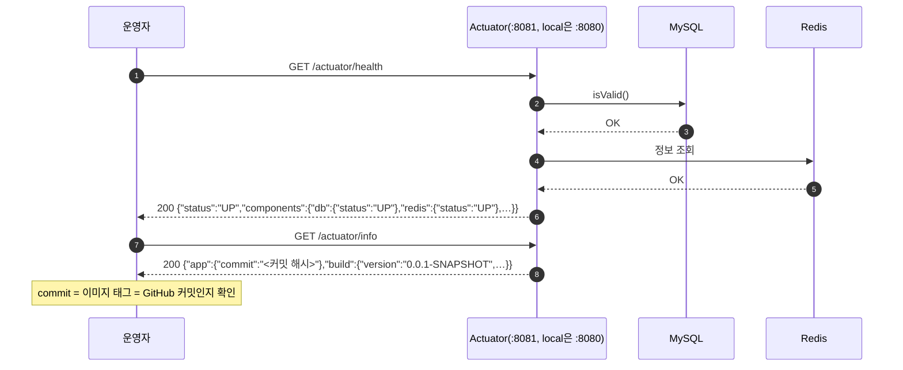
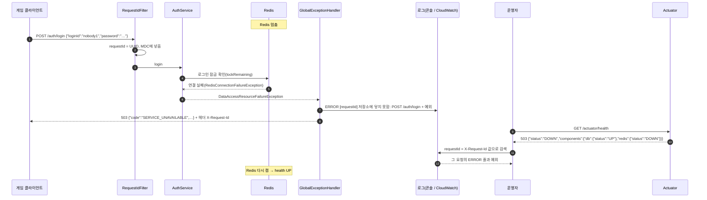
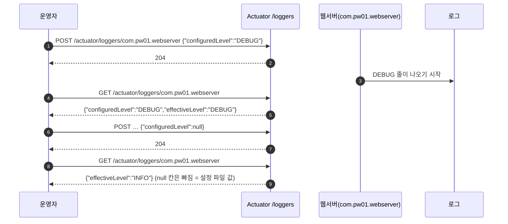

# 운영 확인 흐름 (M12: Actuator·요청 번호로 원인 찾기)

> 상태: 초안(웹서버 PR `feat/m12-actuator` 기준) · 설정: 웹서버 `application.properties` Actuator 절, `application-prod.properties` · 설명: 웹서버 `README.md` "운영 확인"

운영자가 서버 상태를 보고, 장애가 나면 응답의 요청 번호로 로그를 찾아 원인까지 가는 흐름입니다. 게임 API 명세는 바뀌지 않습니다(Actuator는 운영자용 주소).

## 주소

| 프로필 | 게임 API | Actuator(`health`·`info`·`metrics`·`loggers`·`stagecontent`) | 로그 |
|---|---|---|---|
| `local`·`test` | `:8080` | `:8080/actuator/*` | 줄 로그 `%5p [serverId requestId]` |
| `prod` | `:8080` | **`:8081/actuator/*`만**(관리 포트 `MANAGEMENT_PORT`, 밖에 열지 않음). `:8080/actuator/*`는 404 | 한 줄 JSON(ECS), `requestId`·`serverId` 칸 |

- 모든 응답에 헤더 `X-Server-Id`(그 요청을 받은 서버 번호, 8자)가 붙습니다. 서버가 여러 대일 때 어느 서버 로그를 볼지 정합니다([서버 번호로 로그 찾기](#서버-번호로-로그-찾기)).
- `stagecontent`는 웨이브 정의 다시 읽기입니다([웨이브 정의 다시 읽기](#웨이브-정의-다시-읽기)).

- 게임(타이틀 확인)과 밖에서 보는 상태 확인은 게임 API 포트의 **`GET /health`**입니다(두 프로필 모두 `:8080/health`, 배포는 로드 밸런서 주소`/health`). DB·Redis 상태로 200 `{"status":"UP"}` / 503 `{"status":"DOWN"}`만 돌려주고 하위 상태는 보이지 않습니다([명세 README 재전송 규칙](../contracts/README.md#재전송-규칙) "서버 상태 확인"). 하위 상태가 필요하면 아래 Actuator `health`를 봅니다.

## 참여자

| 이름 | 저장소·위치 | 하는 일 |
|---|---|---|
| 운영자 | 브라우저 | Actuator 주소를 부르고 로그를 검색 |
| 게임 클라이언트 | 게임 | 게임 API 호출(예: `POST /auth/login`) |
| `RequestIdFilter` | 웹서버 `common/web/` | 요청마다 UUID → 응답 헤더 `X-Request-Id`, 로그 MDC `requestId` |
| `AuthService` 등 | 웹서버 각 기능 `service/` | 저장소(MySQL·Redis)를 부름 |
| `GlobalExceptionHandler` | 웹서버 `common/error/` | 저장소 연결 실패 → 503 `SERVICE_UNAVAILABLE`, `ERROR 저장소에 닿지 못함` 로그 |
| Actuator | 웹서버(Spring Boot) | `health`(DB·Redis 하위 상태), `info`(버전·커밋), `metrics`, `loggers` |
| MySQL·Redis | compose / AWS | 저장소 |

## ① 정상 상태 확인



```json
// GET /actuator/info (prod 이미지)
{ "app": { "commit": "8fcffa4…(40자)" },
  "build": { "artifact": "pw01-webserver", "name": "pw01-webserver", "group": "com.pw01",
             "version": "0.0.1-SNAPSHOT", "time": "2026-10-13T06:30:04.042Z" } }
```

## ② Redis 장애 → 503 → 요청 번호로 로그 찾기



- 요청 번호는 **오류 응답 본문에는 없고 헤더에만** 있습니다(성공 응답은 본문 `meta.requestId`에도 있음).
- 아이디가 형식(영문·숫자 4~20자)에 맞아야 Redis까지 갑니다. 형식이 틀리면 Redis를 보지 않고 401입니다.
- Redis 연결 끊김을 알아채기까지 몇 초 걸릴 수 있습니다.

```json
// prod 로그 한 줄(모양, 줄여 적음)
{"@timestamp":"2026-10-13T07:10:00.123Z","log":{"level":"ERROR","logger":"com.pw01.webserver.common.error.GlobalExceptionHandler"},
 "message":"저장소에 닿지 못함: POST /auth/login","requestId":"3f2c…","error":{"type":"org.springframework.data.redis.RedisConnectionFailureException",…}}
```

## ③ 실행 중 로그 수준 바꾸기



- 재시작하지 않고 바뀌며, 서버를 다시 띄우면 설정 파일 값으로 돌아갑니다.
- 서버가 여러 대면 한 대씩(각 서버의 관리 포트로) 바꿉니다.

## 웨이브 정의 다시 읽기

배포 서버가 S3의 웨이브 구성(`content/stage-waves.json`)을 재시작 없이 다시 읽는 관리 포트 주소입니다(판 12). 바꾸는 순서·검사·되돌리기는 [stage-api.md 웨이브 구성 바꾸기(재시작 없이)](../contracts/stage-api.md#웨이브-구성-바꾸기재시작-없이), 경우별 흐름도는 [server-wave.md ⑥](server-wave.md)에 있습니다. 게임은 부르지 않습니다.

| 요청 | 주소(`prod`, 서버 안에서) | 하는 일 |
|---|---|---|
| 지금 상태 | `GET http://localhost:8081/actuator/stagecontent` | 지금 쓰는 정의와 마지막 확인·거절 |
| 다시 읽기 | `POST http://localhost:8081/actuator/stagecontent`(본문 없음) | S3를 확인해 바뀌었으면 검사 → 교체 → **다른 서버에 알림** |

- 관리 포트는 밖에 열지 않습니다(보안 그룹). Session Manager로 서버 하나에 들어가 `curl`로 부릅니다. 다른 서버는 Redis 서버 사이 전달(kind `CONTENT_CHANGED`)로 따라오고, 놓치면 5분 안에 스스로 확인합니다.
- 응답은 Actuator 모양(`{data, meta}`로 감싸지 않음)이고 결과와 상관없이 200입니다. 결과는 `result` 칸으로 가립니다.
- `local`·`test`는 이미지 안 파일을 쓰므로 다시 읽기를 하지 않습니다(`result` `NOT_S3`). 로컬에서 파일 출처를 켜면(웹서버 README) S3와 같은 결과 넷이 나오고 `source`가 `file:…`입니다. 관리 포트가 따로 없어 `:8080`(로컬 두 앱이면 `:8081`·`:8082`)으로 부릅니다.

**`GET` 응답**

```json
{
  "source": "s3://pw01-content-<무작위>/content/stage-waves.json",
  "waveVersion": "w4-m2-d1",
  "loadedAt": "2026-10-18T00:12:03.120Z",
  "lastCheckAt": "2026-10-18T00:15:00.004Z",
  "lastRejected": null,
  "serverId": "a1b2c3d4"
}
```

| 칸 | 뜻 |
|---|---|
| `source` | 읽는 곳(`classpath:master/stage-waves.json` 또는 `s3://버킷/키`) |
| `waveVersion` | 지금 정의의 웨이브 정보 버전(새 판 P1이 저장하는 값) |
| `loadedAt` | 지금 정의를 읽은 시각(뜰 때 또는 마지막 교체) |
| `lastCheckAt` | 마지막으로 S3를 확인한 시각(신호·알림·5분 확인). 없으면 `null` |
| `lastRejected` | 마지막으로 거절한 파일 `{at, reason}`. 없으면 `null` |
| `serverId` | 이 서버 번호(응답 헤더 `X-Server-Id`와 같음) |

**`POST` 응답 — 경우별**

| `result` | 언제 | 서버가 하는 일 |
|---|---|---|
| `CHANGED` | S3 파일이 바뀌었고 검사 통과 | 새 정의로 교체, 다른 서버에 알림 |
| `UNCHANGED` | 지난번과 같은 파일(ETag 같음) | 아무것도 안 함 |
| `REJECTED` | 바뀌었지만 검사 실패(모양·웨이브 수·모르는 몬스터·`version` 그대로 등) | 이전 정의 유지, 같은 파일은 다시 시도하지 않음 |
| `SOURCE_ERROR` | S3를 읽지 못함(권한·네트워크) | 이전 정의 유지 |
| `NOT_S3` | 이 서버가 이미지 안 파일을 씀(`local`·`test`) | 아무것도 안 함 |

```json
{ "result": "CHANGED", "before": "w3-m2-d1", "waveVersion": "w4-m2-d1", "serverId": "a1b2c3d4" }
```

```json
{ "result": "UNCHANGED", "before": "w4-m2-d1", "waveVersion": "w4-m2-d1", "serverId": "a1b2c3d4" }
```

```json
{
  "result": "REJECTED",
  "before": "w4-m2-d1",
  "waveVersion": "w4-m2-d1",
  "reason": "[master/stage-waves.json] stage.01.01: waves 수(4)가 waveCount(5)와 다릅니다.",
  "serverId": "a1b2c3d4"
}
```

```json
{
  "result": "SOURCE_ERROR",
  "before": "w4-m2-d1",
  "waveVersion": "w4-m2-d1",
  "reason": "s3://pw01-content-<무작위>/content/stage-waves.json을 읽지 못했습니다 status=403 (서버 역할에 이 경로 읽기 권한이 없거나 키가 없음. 목록 권한이 없어 없는 키도 403)",
  "serverId": "a1b2c3d4"
}
```

- `reason` 문구는 서버 검사기의 메시지 그대로입니다(위는 예). 게임에 보이지 않으므로 바뀔 수 있습니다.
- `/actuator/info`의 `content` 칸에도 `source`·`waveVersion`·`loadedAt`이 있어 두 서버가 같은 정의인지 한 번에 봅니다.

**볼 로그**(`[Content]`)

| 때 | 로그 |
|---|---|
| 뜰 때 | `[Content] 정의 읽음 source=s3://…/content/stage-waves.json waveVersion=w3-m2-d1` |
| 교체 | `[Content] 정의 교체 w3-m2-d1 → w4-m2-d1 reason=signal`(`relay` = 다른 서버 알림, `poll` = 5분 확인) |
| 거절 | `[Content] 정의 교체 거절 reason=… — w4-m2-d1 유지` |
| S3 실패 | `[Content] 정의 확인 실패 … — w4-m2-d1 유지` |

## 서버 번호로 로그 찾기

서버가 여러 대(로드 밸런서 뒤)이면 요청 번호만으로는 어느 서버 로그인지 모릅니다. 응답 헤더 `X-Server-Id`가 그 요청을 받은 서버입니다.

1. 응답 헤더에서 `X-Request-Id`와 `X-Server-Id`를 적습니다(게임 로그·Postman).
2. 서버마다 뜰 때 로그 `[Relay] serverId=… host=…`가 있습니다. `X-Server-Id`와 같은 줄을 찍은 서버(EC2)를 고릅니다. 서버 번호는 뜰 때마다 바뀝니다.
3. 그 서버에서 `docker logs pw01-webserver | grep <요청 번호>`. 배포 서버 로그(ECS JSON)에는 `serverId` 칸도 있습니다.
