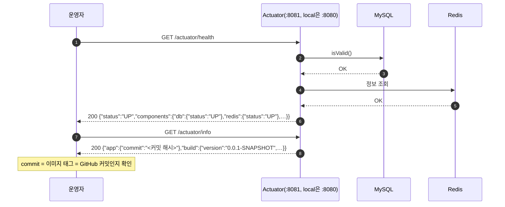
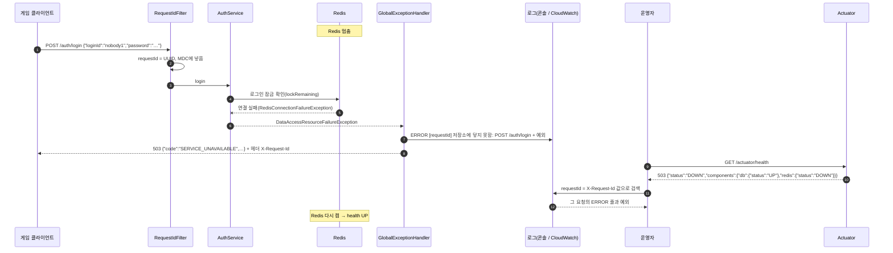
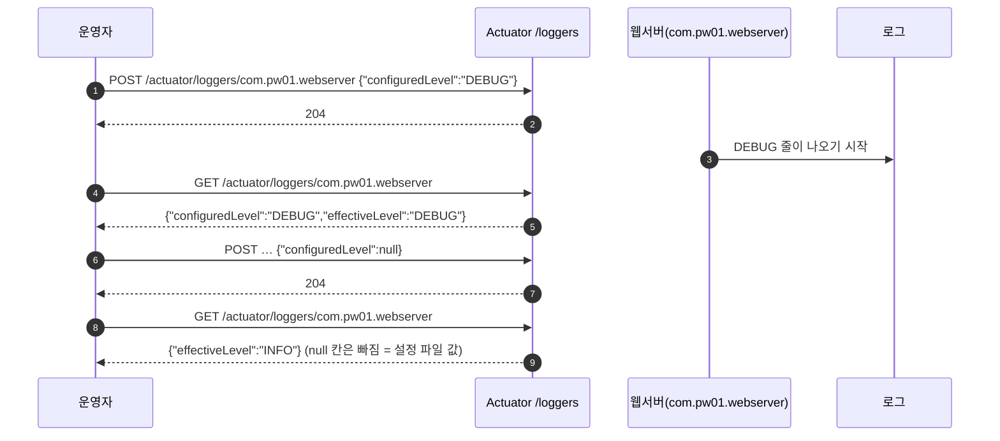

# 운영 확인 흐름 (M12: Actuator·요청 번호로 원인 찾기)

> 상태: 초안(웹서버 PR `feat/m12-actuator` 기준) · 설정: 웹서버 `application.properties` Actuator 절, `application-prod.properties` · 설명: 웹서버 `README.md` "운영 확인"

운영자가 서버 상태를 보고, 장애가 나면 응답의 요청 번호로 로그를 찾아 원인까지 가는 흐름입니다. 게임 API 명세는 바뀌지 않습니다(Actuator는 운영자용 주소).

## 주소

| 프로필 | 게임 API | Actuator(`health`·`info`·`metrics`·`loggers`) | 로그 |
|---|---|---|---|
| `local`·`test` | `:8080` | `:8080/actuator/*` | 줄 로그 `%5p [requestId]` |
| `prod` | `:8080` | **`:8081/actuator/*`만**(관리 포트 `MANAGEMENT_PORT`, 밖에 열지 않음). `:8080/actuator/*`는 404 | 한 줄 JSON(ECS), `requestId` 칸 |

## 참여자

| 이름 | 저장소·위치 | 하는 일 |
|---|---|---|
| 운영자 | 브라우저 | Actuator 주소를 부르고 로그를 검색 |
| 게임 클라이언트 | 게임 | 게임 API 호출(예: `POST /auth/login`) |
| `RequestIdFilter` | 웹서버 `common/web/` | 요청마다 UUID → 응답 헤더 `X-Request-Id`, 로그 MDC `requestId` |
| `AuthService` 등 | 웹서버 각 기능 `service/` | 저장소(MySQL·Redis)를 부름 |
| `GlobalExceptionHandler` | 웹서버 `common/error/` | 저장소 연결 실패 → 503 `SERVICE_UNAVAILABLE`, `ERROR 저장소에 닿지 못함` 로그 |
| Actuator | 웹서버(Spring Boot) | `health`(DB·Redis 하위 상태), `info`(버전·커밋), `metrics`, `loggers` |
| MySQL·Redis | compose / AWS | 저장소 |

## ① 정상 상태 확인



```json
// GET /actuator/info (prod 이미지)
{ "app": { "commit": "8fcffa4…(40자)" },
  "build": { "artifact": "pw01-webserver", "name": "pw01-webserver", "group": "com.pw01",
             "version": "0.0.1-SNAPSHOT", "time": "2026-10-13T06:30:04.042Z" } }
```

## ② Redis 장애 → 503 → 요청 번호로 로그 찾기



- 요청 번호는 **오류 응답 본문에는 없고 헤더에만** 있습니다(성공 응답은 본문 `meta.requestId`에도 있음).
- 아이디가 형식(영문·숫자 4~20자)에 맞아야 Redis까지 갑니다. 형식이 틀리면 Redis를 보지 않고 401입니다.
- Redis 연결 끊김을 알아채기까지 몇 초 걸릴 수 있습니다.

```json
// prod 로그 한 줄(모양, 줄여 적음)
{"@timestamp":"2026-10-13T07:10:00.123Z","log":{"level":"ERROR","logger":"com.pw01.webserver.common.error.GlobalExceptionHandler"},
 "message":"저장소에 닿지 못함: POST /auth/login","requestId":"3f2c…","error":{"type":"org.springframework.data.redis.RedisConnectionFailureException",…}}
```

## ③ 실행 중 로그 수준 바꾸기



- 재시작하지 않고 바뀌며, 서버를 다시 띄우면 설정 파일 값으로 돌아갑니다.
- 서버가 여러 대면 한 대씩(각 서버의 관리 포트로) 바꿉니다.
