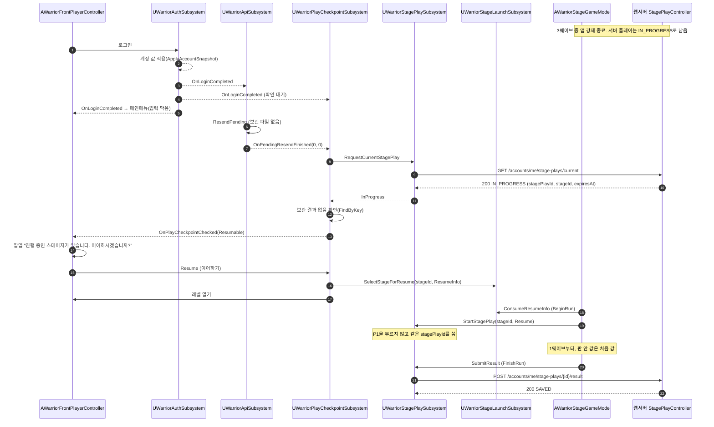
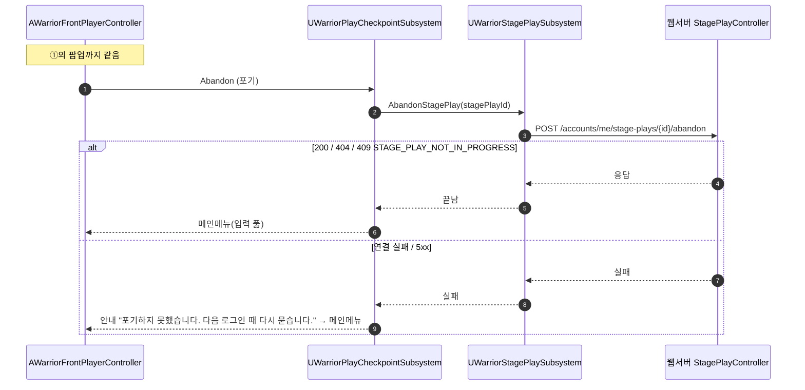
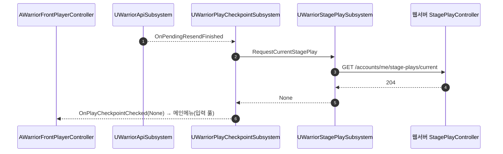
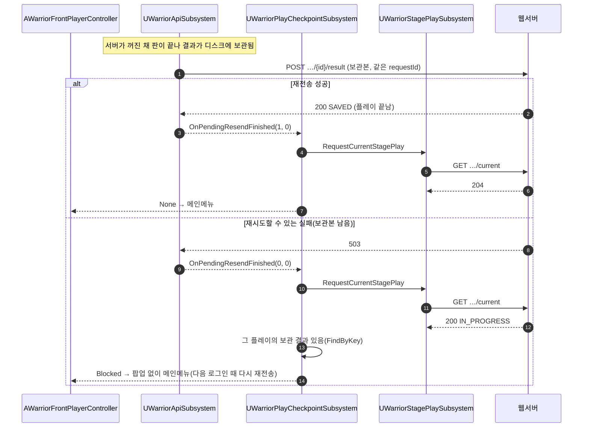
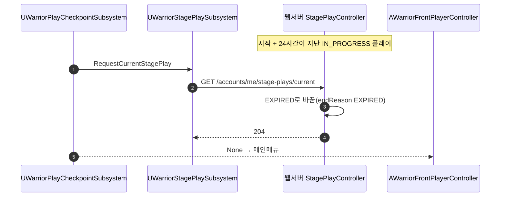

# 플레이 체크포인트 흐름 (M22 1차: 진행 중 스테이지 이어하기)

> 상태: 초안 · 명세: [stage-play-api.md 이어하기(1차)](../contracts/stage-play-api.md#이어하기1차) · 재전송: [README.md 재전송 규칙](../contracts/README.md#재전송-규칙)

판 도중 게임이 꺼지거나 로그인 상태가 끝난 뒤 다시 로그인했을 때의 흐름입니다. 1차는 **같은 `stagePlayId`로 그 스테이지를 처음(1웨이브)부터** 다시 합니다. 서버 API는 바뀌지 않습니다.

## 참여자

| 이름 | 저장소·위치 | 하는 일 |
|---|---|---|
| `UWarriorAuthSubsystem` | 게임 `Auth/` | 로그인, 계정 값 적용, `OnLoginCompleted`·`OnSessionEnded` |
| `UWarriorApiSubsystem` | 게임 `Network/` | 보관 요청 재전송, 끝나면 `OnPendingResendFinished` |
| `UWarriorPlayCheckpointSubsystem` | 게임 `Network/` | 로그인 뒤 진행 중 플레이 확인, 이어하기·포기 |
| `UWarriorStagePlaySubsystem` | 게임 `Network/` | P1·P2·P4·결과 제출 |
| `UWarriorStageLaunchSubsystem` | 게임 `Stage/` | 고른 스테이지와 이어하기 정보(`FWarriorStageResumeInfo`) |
| `AWarriorFrontPlayerController` | 게임 `Controllers/` | 메인메뉴, 이어하기 팝업 |
| `AWarriorStageGameMode` | 게임 `GameModes/` | `BeginRun`(플레이 시작), `FinishRun`(결과) |
| `StagePlayController` | 웹서버 `stageplay/` | `/accounts/me/stage-plays` |

## ① 판 도중 강제 종료 → 다시 로그인 → 이어하기

## ② 팝업 → 포기

## ③ 진행 중 플레이 없음

## ④ 보관 결과가 있음 → 재전송이 먼저

## ⑤ 마감이 지남

## 다음 단계(최종 완성)에서 더할 흐름

- ⑥ 웨이브 경계마다 `PUT /accounts/me/stage-plays/{id}/checkpoint`로 판 안 값을 올리고, 이어하기 때 `GET …/checkpoint`로 받아 그 웨이브부터 시작합니다.
