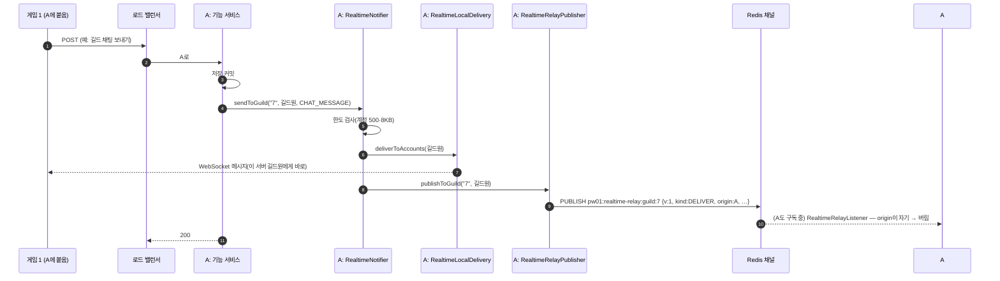
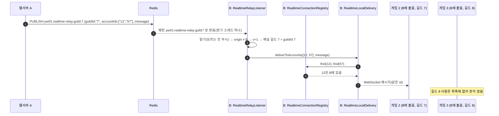
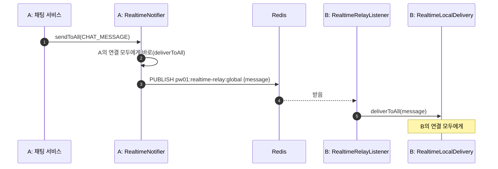
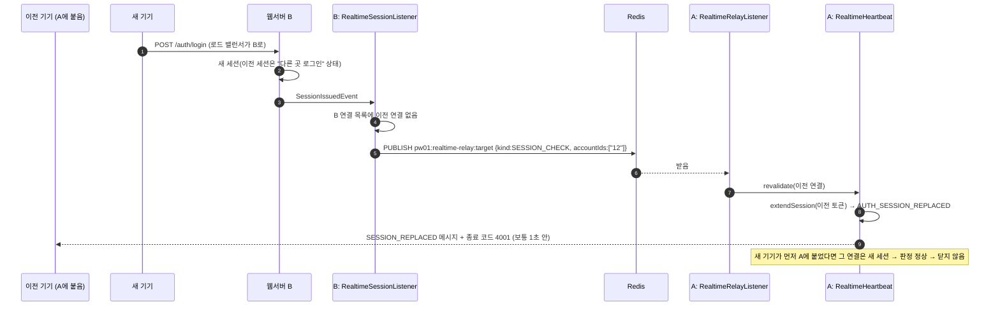
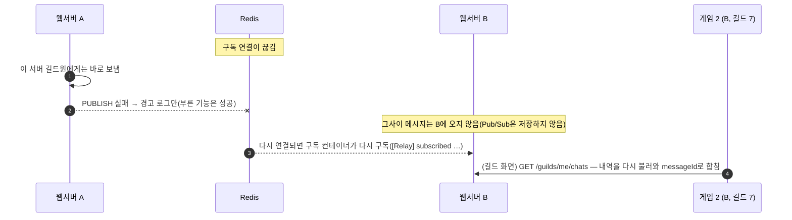
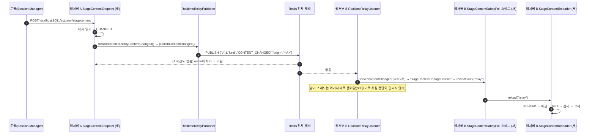

# 실시간 서버 사이 전달 흐름 (M23 뼈대, SF-11)

> 상태: 초안 · 명세: [realtime-api.md 서버 여러 대](../contracts/realtime-api.md#서버-여러-대), [메시지 종류](../contracts/realtime-api.md#메시지-종류) · Redis: [redis-keys.md 실시간 서버 사이 전달](../contracts/redis-keys.md#실시간-서버-사이-전달v15) · 배포 모양: 로드 밸런서 뒤 웹서버 여러 대(로컬은 웹서버 `compose.apps.yaml`의 nginx + 앱 둘)

로드 밸런서는 HTTP 요청을 요청마다 아무 서버로 보내고, WebSocket은 처음 붙은 서버에 계속 붙여 둡니다. 그래서 "알림을 보내는 HTTP를 받은 서버"와 "받는 사람의 WebSocket이 붙은 서버"가 다를 수 있습니다. 서버들은 Redis Pub/Sub 채널로 메시지를 서로 넘기고, 각 서버는 **자기에게 붙은 사람에게만** 보냅니다.

- ① 같은 서버 · ② 다른 서버(길드 채널) · ③ 전체(전체 채널) · ④ 다른 곳 로그인(세션 다시 확인) · ⑤ Redis가 잠깐 끊김 · ⑥ 서버끼리 알림: 웨이브 정의 바뀜(`CONTENT_CHANGED`, 게임에 안 감)

## 참여자

| 이름 | 저장소·위치 | 하는 일 |
|---|---|---|
| 기능 서비스(예: 채팅 `ChatService`) | 웹서버 각 기능 | DB 커밋 뒤 `RealtimeNotifier`의 보내기를 부름 |
| `RealtimeNotifier` | 웹서버 `realtime/service` | 보내기 입구 넷(`send`·`sendToAccounts`·`sendToGuild`·`sendToAll`). 한도 검사 → 이 서버 전달 → 채널에 올림 |
| `RealtimeLocalDelivery` | 웹서버 `realtime/service` | 이 서버 연결 목록에서 대상을 골라 WebSocket으로 보냄 |
| `RealtimeConnectionRegistry` | 웹서버 `realtime/service` | 계정 → 연결(이 서버 메모리) |
| `RealtimeRelayPublisher` | 웹서버 `realtime/repository` | 서버 사이 메시지(JSON)를 채널에 올림(`convertAndSend`). 실패해도 예외를 던지지 않음 |
| `RealtimeRelayListener` | 웹서버 `realtime/service` | 채널에서 받아 거름(자기 것·판·길드 맞춤) → `RealtimeLocalDelivery` 또는 `RealtimeHeartbeat.revalidate` |
| `RealtimeRelayConfig` | 웹서버 `config` | 구독 컨테이너: 전체·지정 채널 + 길드 패턴 `pw01:realtime-relay:guild:*`, 받기 스레드 하나 |
| `RealtimeHeartbeat` | 웹서버 `realtime/service` | Pong 연장과 "세션 다시 확인"이 같이 쓰는 판정 `revalidate` |
| `RealtimeSessionListener` | 웹서버 `realtime/service` | 로그인 이벤트 → 이 서버 연결에 4001 + 다른 서버에 세션 다시 확인 |
| `StageContentEndpoint`·`StageContentReloader` (새, 판 12) | 웹서버 `stage/` | 관리 포트 신호로 웨이브 정의를 다시 읽고, 바뀌었으면 `RealtimeNotifier.notifyContentChanged()`로 `CONTENT_CHANGED`를 올림. 받은 쪽은 `RealtimeEventPublisher`가 `ServerContentChangedEvent`를 내고 `StageContentChangeListener`가 다시 읽기를 **전용 스레드**(`StageContentSafetyPoll`)에 맡김 |
| Redis 채널 | `pw01:realtime-relay:global` / `:guild:<길드 ID>` / `:target` | 서버 사이 전달(키 아님, 저장 안 함) |
| `UWarriorRealtimeSubsystem` | 게임 `Network/` | WebSocket 메시지 받기(모르는 종류는 무시) |

## ① 같은 서버에 붙은 사람

- 자기 서버에는 채널을 거치지 않고 바로 보냅니다. Redis가 막혀도 같은 서버 사람은 받습니다.

## ② 다른 서버에 붙은 사람(길드마다 채널)

- 채널의 길드와 메시지의 `guildId`가 다르면 버립니다(다른 길드에 가지 않게).
- 받는 서버는 길드를 다시 묻지 않습니다. 대상은 보낸 서버가 넣은 길드원 목록입니다.

## ③ 전체 채팅(전체 채널)

- 전체 채팅은 지금 서버에 저장하지 않습니다(`NoStoreGlobalChatHistory`). 나중에 들어온 사람은 그 전 전체 채팅을 볼 수 없습니다.

## ④ 다른 곳 로그인 — 이전 연결이 다른 서버에 있을 때

- 이 전달을 놓쳐도 이전 연결의 다음 Pong(최대 60초)에서 같은 판정으로 `4001`이 됩니다.
- 로그아웃은 서버 사이로 넘기지 않습니다(게임이 스스로 연결을 닫음).

## ⑤ Redis가 잠깐 끊김

- 놓칠 수 있다는 것은 명세의 원칙입니다. 길드 채팅은 내역으로 채우고, 전체 채팅은 지금은 잃은 채로 둡니다.

## ⑥ 서버끼리 알림: 웨이브 정의 바뀜(판 12)

게임에 보내는 메시지가 아니라 **서버끼리** 쓰는 kind입니다([redis-keys.md](../contracts/redis-keys.md#실시간-서버-사이-전달v15) v1.9). 운영자가 S3 웨이브 정의를 바꾸고 서버 A의 관리 포트에 다시 읽기를 보내면, A가 바꾼 뒤 다른 서버에 알립니다. 정의 쪽 경우별 흐름은 [server-wave.md ⑥](server-wave.md)에 있습니다.

- 이 kind를 모르는 옛 서버(배포 중 섞여 돌 때)는 `[Relay] dropped: unknown kind=CONTENT_CHANGED …`로 버리고, 5분 주기 확인으로 따라옵니다. Redis가 끊긴 동안 놓친 알림도 같은 주기 확인이 메웁니다.
- 게임 연결(`RealtimeLocalDelivery`)로는 보내지 않습니다. 받기 로그는 `[Relay] content changed origin=…`입니다.

## 로그로 확인하기

| 무엇 | 로그(웹서버) |
|---|---|
| 서버 번호 | 뜰 때 `[Relay] serverId=<8자> host=<호스트>`. 모든 HTTP 응답 헤더 `X-Server-Id`와 같은 값 |
| 구독 | `[Relay] subscribed channel=…` / `pattern=pw01:realtime-relay:guild:*` |
| 이 서버에서 보냄 | `[Realtime] sent type=… id=… RealtimeConnection[accountId=…]` |
| 버림 | `[Relay] dropped: …`(이유), `[Realtime] not sent: …`(한도) |
| 올리기 실패 | `[Relay] publish failed channel=…` |

같은 메시지 `id`로 두 서버 로그를 찾으면 어느 서버에서 누구에게 갔는지 이어집니다.
