# 서버 웨이브 구성 흐름 (M24: 서버 주관 웨이브 · 몬스터 카탈로그, M9: 난이도)

> 상태: 초안(구현 전) · 명세: [stage-api.md 서버 정의 파일](../contracts/stage-api.md#서버-정의-파일)·[난이도](../contracts/stage-api.md#난이도), [stage-play-api.md 웨이브 구성](../contracts/stage-play-api.md#웨이브-구성), [이어하기](../contracts/stage-play-api.md#이어하기) · 함께 보기: [play-checkpoint.md](play-checkpoint.md)

웨이브 구성(몬스터·수·보스·골드·쉬는 시간)의 원본은 **서버 파일**입니다. 서버는 판을 시작할 때 구성을 만들어 플레이에 고정하고, 게임은 받은 구성으로만 웨이브를 만듭니다. 이어하기도 같은 구성을 씁니다.
- ①~② 판 시작(보통·체크포인트에서 이어하기)
- ③~④ 구성을 쓸 수 없을 때
- ⑤ 스테이지 선택 미리보기
- ⑥ 서버: 정의 파일(배포 서버의 웨이브 구성은 S3), 재시작 없이 바꾸기·검사 실패·놓친 알림·되돌리기·뜰 때 S3 실패, 정의가 바뀐 뒤의 진행 중 판
- ⑦ 난이도 고르기 → 서버가 반영한 구성 → 적 능력치 배율(M9, 작성안)

`(새)`는 M24에서 새로 만드는 클래스·함수입니다.

## 참여자

| 이름 | 저장소·위치 | 하는 일 |
|---|---|---|
| `AWarriorStageGameMode` | 게임 `GameModes/` | `BeginRun`(플레이 시작·체크포인트 넣기), `OnWavePlanChanged`를 받아 FlowManager에 웨이브를 넣음(`ApplyServerWavePlan`), 못 쓰면 `FailRunStart` |
| `UWarriorStagePlaySubsystem` | 게임 `Network/` | P1, `StartStagePlay`, `ApplyWavePlan`(새, 구성 입구), `OnWavePlanChanged`·`GetWavePlanState`(새) |
| `UWarriorMonsterCatalogDataAsset`·`DA_MonsterCatalog` (새) | 게임 `Stage/` | 몬스터 키 → BP |
| `AWarriorStageFlowManager` | 게임 `Stage/` | 웨이브 데이터 보관, 웨이브마다 스포너에 넘김 |
| `UWarriorPlayCheckpointSubsystem` | 게임 `Network/` | 로그인 뒤 P2·C2, 이어하기 팝업 판단(`CanResumeInThisBuild`) |
| `UWarriorStageLaunchSubsystem` | 게임 `Stage/` | 이어하기 정보 `FWarriorStageResumeInfo`(`Play` 칸 새로) |
| `UWarriorApiSubsystem` | 게임 `Network/` | `PresentError`(오류 문구 표 → 팝업) |
| `UWarriorStageListSubsystem` | 게임 `Network/` | 스테이지 선택 화면 데이터(ST1·ST2), `BuildWaveInfo` |
| `StagePlayController`·`StagePlayService` | 웹서버 `stageplay/` | P1~P4, 시작 때 구성 고정 |
| `StageCatalog`·`StageMasterValidator` | 웹서버 `stage/` | 정의 파일 읽기·기동 검사·풀어 둔 구성 |
| `StageWaveMasterFile`·`MonsterMasterFile` (새) | 웹서버 `stage/master/` | `master/stage-waves.json`·`master/monsters.json` |
| `StageController` | 웹서버 `stage/` | ST1 `GET /stages` |

## ① 보통 시작

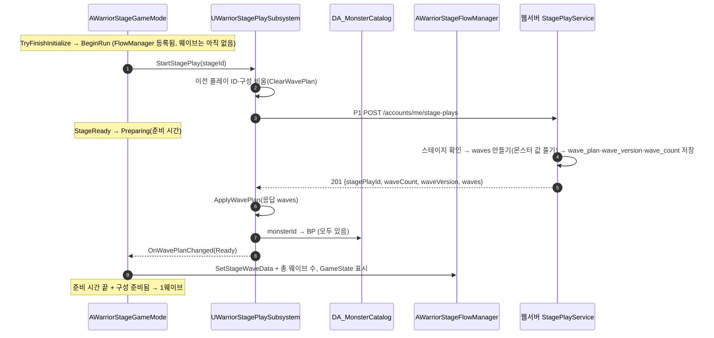

## ② 체크포인트에서 이어하기

로그인 때 받은 P2 응답의 구성을 이어하기 정보에 실어 옵니다. 레벨을 연 뒤에는 서버에 다시 묻지 않습니다. **구성을 체크포인트보다 먼저** 넣습니다(체크포인트 범위 검사가 총 웨이브 수를 씀).

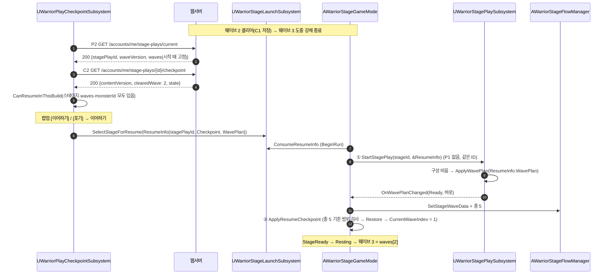

- 체크포인트가 없는 이어하기(C2 204·버전 다름·실패)는 같은 길에서 ②만 건너뛰고 1웨이브부터 합니다.
- 체크포인트에는 구성이 없습니다. 구성은 플레이(`wave_plan`), 어디까지 깼는지는 체크포인트(Redis)에 있고 둘 다 같은 `stagePlayId`입니다.

## ③ 구성을 쓸 수 없음 → 판을 시작하지 않음

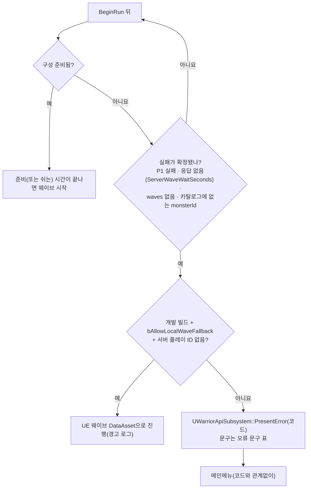

| 경우 | 코드 | 어디서 |
|---|---|---|
| P1이 오류 응답 | 서버 코드 그대로(`STAGE_LOCKED`·`STAGE_NOT_FOUND`·`SERVICE_UNAVAILABLE` 등) | 서버 |
| P1 연결 실패 | `NETWORK_ERROR` | 게임 |
| 준비 시간이 끝난 뒤에도 응답이 없음 | `STAGE_WAVE_PLAN_TIMEOUT` | 게임 안 코드 |
| 응답에 `waves`가 없거나 `null` | `STAGE_WAVE_PLAN_MISSING` | 게임 안 코드 |
| 카탈로그에 없는 `monsterId` | `STAGE_WAVE_MONSTER_UNKNOWN` | 게임 안 코드 |

- 서버 플레이 ID가 없는 판은 디버그 명령 `Warrior.Checkpoint.ResumeLevel`이나 서버 없이 하는 시험뿐입니다. 서버 판에는 로컬 DataAsset의 적이 섞이지 않습니다.

## ④ 이어하기 팝업: 이 빌드에서 열 수 없는 플레이

판 시작 단계에서 실패하면 플레이가 진행 중으로 남아 로그인마다 같은 실패가 되풀이됩니다. 그래서 팝업에서 먼저 거릅니다.

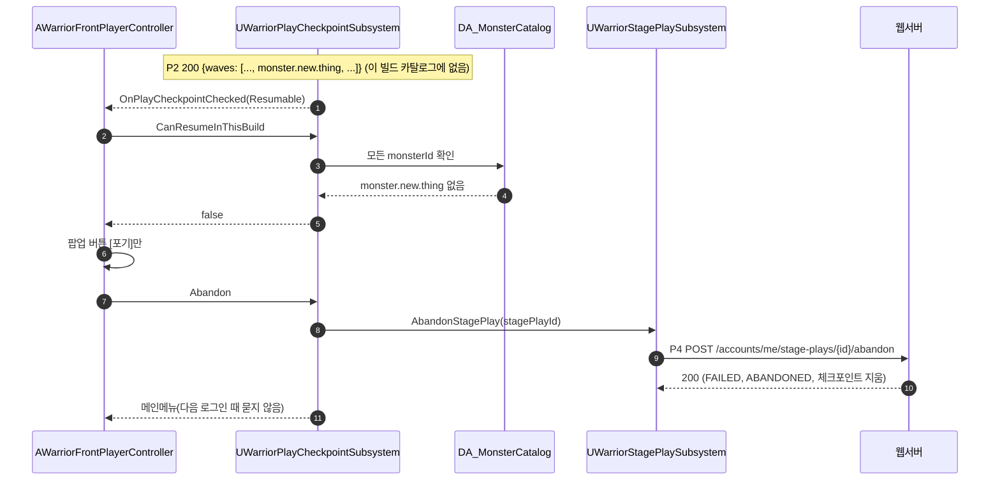

- 같은 이유로 스테이지가 이 빌드의 목록에 없거나 `waves`가 `null`이어도 [포기]만입니다.

## ⑤ 스테이지 선택 미리보기

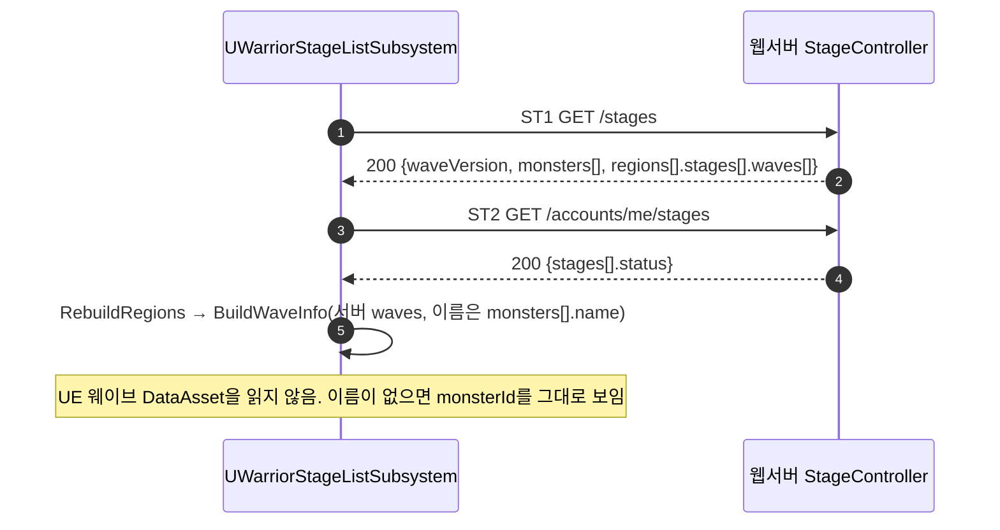

- 미리보기는 **지금** 서버 정의입니다. 진행 중인 판의 구성(시작 때 고정)과 `waveVersion`이 다를 수 있습니다.

## ⑥ 서버: 정의 파일과 정의가 바뀐 뒤

명세: [stage-api.md 서버 정의 파일](../contracts/stage-api.md#서버-정의-파일)·[웨이브 구성 바꾸기(재시작 없이)](../contracts/stage-api.md#웨이브-구성-바꾸기재시작-없이)(v1.5), 관리 포트 요청·응답은 [ops-health.md 웨이브 정의 다시 읽기](ops-health.md#웨이브-정의-다시-읽기).

- 정의는 한 덩어리(`StageContent`)로 들고, 바꿀 때는 새 덩어리로 참조를 통째로 바꿉니다(`StageCatalog.replace`). 판 시작(P1)은 덩어리 하나를 받아 검사·구성·`waveVersion`을 모두 거기서 읽습니다.
- 배포 서버에서 `stage-waves.json`만 S3(`S3StageWaveSource`)에서 읽습니다. 로컬·시험은 이미지 안 파일(`ClasspathStageWaveSource`)이고 다시 읽기가 없습니다.
- 서버가 여러 대여도 같은 S3 객체를 봅니다. 한 서버에 보낸 다시 읽기 신호는 Redis 서버 사이 전달(kind `CONTENT_CHANGED`, [realtime-relay.md](realtime-relay.md))로 다른 서버에 퍼집니다.
- `(새)`는 이번 작업(판 12)에서 새로 만드는 클래스입니다.

### ⑥-1 뜰 때 읽기

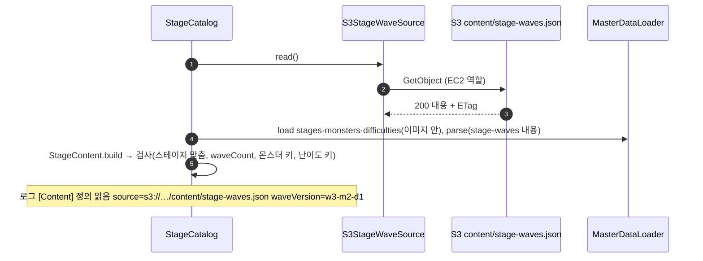

### ⑥-2 웨이브 구성 바꾸기: 올림 → 다시 읽기 → 다른 서버

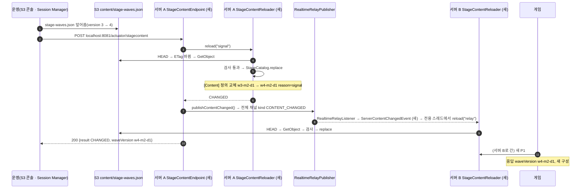

### ⑥-3 검사에 걸림 → 이전 정의 유지

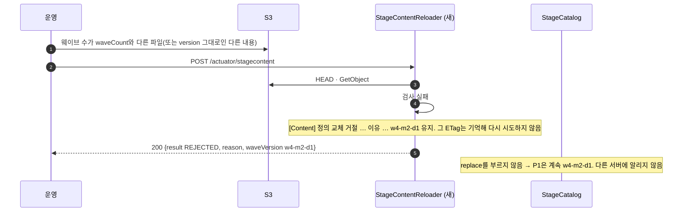

### ⑥-4 알림을 놓친 서버 → 5분 안전망

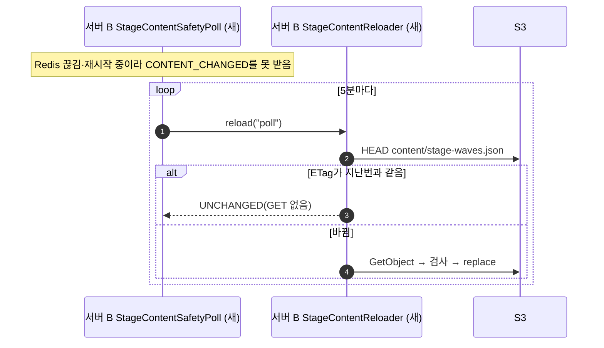

### ⑥-5 진행 중 판과 V9 전 판

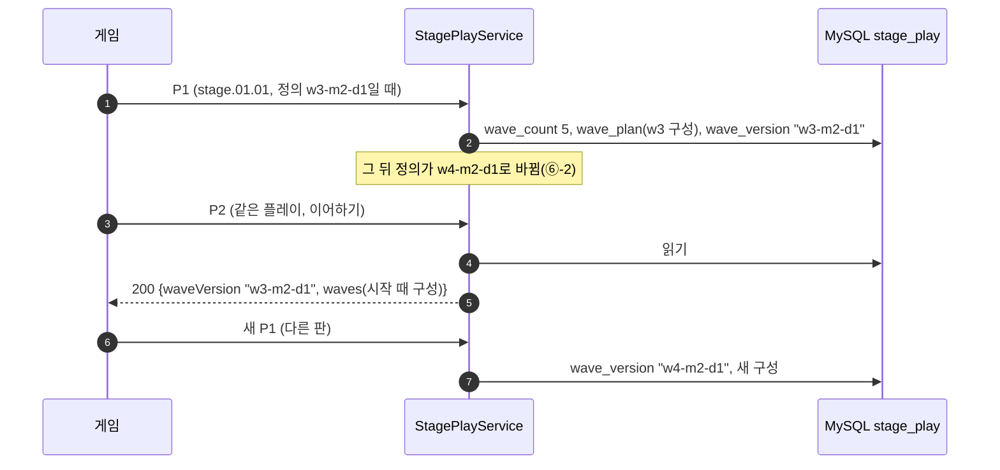

- v1.3 배포 전에 시작한 플레이는 `wave_plan`이 비어 있습니다. 응답할 때 **지금 덩어리 하나**로 채우고(구성과 `waveVersion`이 같은 덩어리), 지금 웨이브 수가 그 플레이의 `waveCount`와 다르면 `waves`·`waveVersion`을 `null`로 보냅니다(게임은 ③·④대로).

### ⑥-6 되돌리기

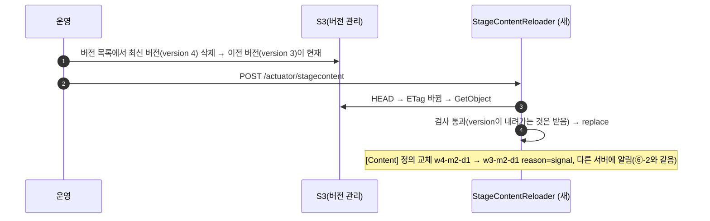

### ⑥-7 뜰 때 S3를 못 읽음 → 기동 실패 → 배포 되돌림

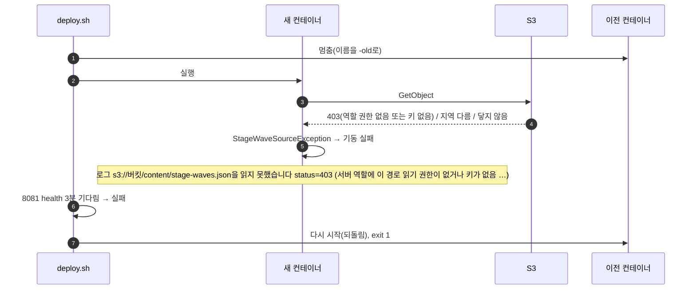

- 이미지 안 파일로 대신 뜨지 않습니다. 대신 뜨면 서버마다 다른 정의를 조용히 쓸 수 있기 때문입니다. 배포 전에 S3에 객체를 올리고 서버 역할 권한을 넣어 둡니다.

## ⑦ 난이도 (M9, 작성안)

난이도는 몬스터 종류를 바꾸지 않고 **마리 수와 능력치만** 바꿉니다. 서버가 P1 때 그 난이도를 구성에 반영해 고정하므로 게임은 계산하지 않습니다. 이어하기는 P2의 `difficulty`·`waves`를 그대로 씁니다.

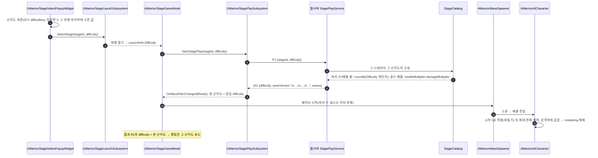

| 경우 | 처리 |
|---|---|
| 서버에 없는 난이도 | P1 400 `VALIDATION_FAILED` → ③대로 판 시작 안 함 |
| 같은 `requestId`로 다른 난이도 | 409 `IDEMPOTENCY_KEY_REUSED`(게임 버그) |
| 이어하기 | P2 `difficulty`를 이어하기 정보에 실음. 구성에 배율이 들어 있어 따로 계산 안 함 |
| v1.4 전 플레이·구성 | 난이도 0, 적 줄 배율 칸이 없으면 1.0 |
| 서버 플레이 없음(개발 시험) | 난이도 0, 배율 1.0, UE 웨이브 DataAsset |
